# Composition guides — 14 photo composition recipes for iPhone

[](LICENSE)
[](https://www.slaycamera.com/?utm_source=github&utm_medium=repo&utm_campaign=composition-guides)

Fourteen field-tested composition recipes for **portrait, travel and food photos** —
each with the exact **camera height, angle, zoom and distance** to use, an annotated
diagram and an example shot. Made by **slay**, the composition-guide camera for iPhone.

Use them as a cheat sheet, teach with them, or build on the data in
[`data/guides.json`](data/guides.json) and [`data/guides.csv`](data/guides.csv).
Free under [CC BY 4.0](LICENSE) — just credit
**slay — [slaycamera.com](https://www.slaycamera.com/?utm_source=github&utm_medium=repo&utm_campaign=composition-guides)**.

```bash
git clone https://github.com/slaycamera/composition-guides.git
```

## The 14 guides at a glance

| # | Guide | Best for | Principle | Setup |
|---|---|---|---|---|
| 1 | [Portrait 1](#1-portrait-1-centered-full-body-portrait) | Portrait | Centered full-body portrait | Full-body portrait, head centered, shot at 1.5x from 4m away. |
| 2 | [Portrait 2](#2-portrait-2-rule-of-thirds-portrait) | Portrait | Rule of thirds portrait | Portrait with the head on the top third line, shot at 2x. |
| 3 | [Close Up](#3-close-up-telephoto-half-body-portrait) | Portrait | Telephoto half-body portrait | Half-body telephoto portrait at 3x for a flattering, flat background. |
| 4 | [Side Chick](#4-side-chick-off-center-environmental-portrait) | Portrait | Off-center environmental portrait | Off-center portrait that lets the scene tell the story, at 3–4x. |
| 5 | [Travel Shot](#5-travel-shot-small-subject-big-scenery) | Travel & scenery | Small subject, big scenery | Small subject at the bottom, big scenery above — the classic travel shot. |
| 6 | [One-Third](#6-one-third-rule-of-thirds--subject-in-the-lower-third) | Travel & scenery | Rule of thirds — subject in the lower third | Main scene in one third of the frame, sky in the other two. |
| 7 | [Two-Third](#7-two-third-rule-of-thirds--subject-fills-two-thirds) | Travel & scenery | Rule of thirds — subject fills two-thirds | Main subject fills two-thirds of the frame, with a strip for balance. |
| 8 | [Vanishing Point](#8-vanishing-point-corner-lines-converging-on-the-subject) | Food & café | Corner lines converging on the subject | Table edges converge on the subject for café and food shots. |
| 9 | [One-Point Vertex](#9-one-point-vertex-single-subject-on-a-grid-intersection) | Food & café | Single subject on a grid intersection | One subject on a grid intersection, empty space opposite. |
| 10 | [Two-Point Vertex](#10-two-point-vertex-two-subjects-on-a-diagonal) | Food & café | Two subjects on a diagonal | Two subjects on a diagonal — small at the bottom, large at the top. |
| 11 | [Triangle 1](#11-triangle-1-three-subjects-in-a-triangle) | Food & café | Three subjects in a triangle | Three items as triangle points in the lower two-thirds. |
| 12 | [Triangle 2](#12-triangle-2-wide-triangle-across-the-frame) | Food & café | Wide triangle across the frame | A wide triangle of three items across the whole table. |
| 13 | [Aerial Triangle](#13-aerial-triangle-top-down-flat-lay-items-in-a-triangle) | Food & café | Top-down flat lay, items in a triangle | Top-down flat lay with the items arranged in a triangle. |
| 14 | [One-Point Aerial](#14-one-point-aerial-top-down-flat-lay-single-hero-dish) | Food & café | Top-down flat lay, single hero dish | Top-down shot of one hero dish on the bottom grid line. |

Prefer one page? See the [cheat sheet](CHEATSHEET.md).

## Portrait

### 1. Portrait 1: Centered full-body portrait

A full-length portrait with the subject standing in the middle of the frame and plenty of scene around them. The centered placement feels calm and confident, and the distance shows the whole outfit.

<p>
  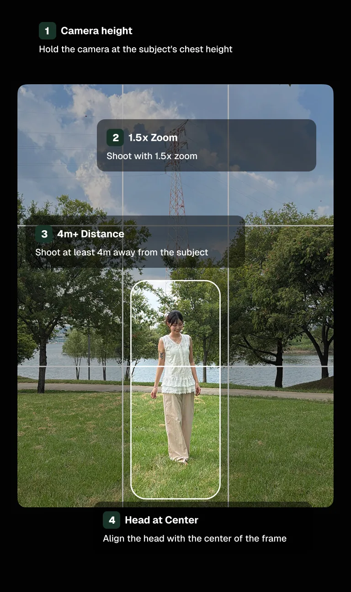
  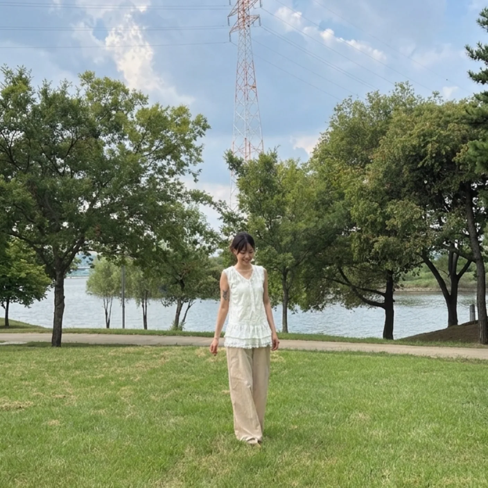
</p>

1. **Camera height** — Hold the camera at the subject's chest height.
2. **1.5x zoom** — Shoot with 1.5x zoom to keep proportions natural.
3. **4m+ distance** — Stand at least 4 metres away from the subject.
4. **Head at center** — Align the subject's head with the center of the frame.

→ Full guide: [Portrait 1 on slaycamera.com](https://www.slaycamera.com/guides/portrait-1?utm_source=github&utm_medium=repo&utm_campaign=composition-guides) ·
Deep dive: [Center your subject, own the frame](https://www.slaycamera.com/blog/center-subject-own-the-frame?utm_source=github&utm_medium=repo&utm_campaign=composition-guides)

### 2. Portrait 2: Rule of thirds portrait

A full or seated portrait with the subject's head on the top third line. Tighter than Portrait 1, so the person fills more of the frame while the setting still reads.

<p>
  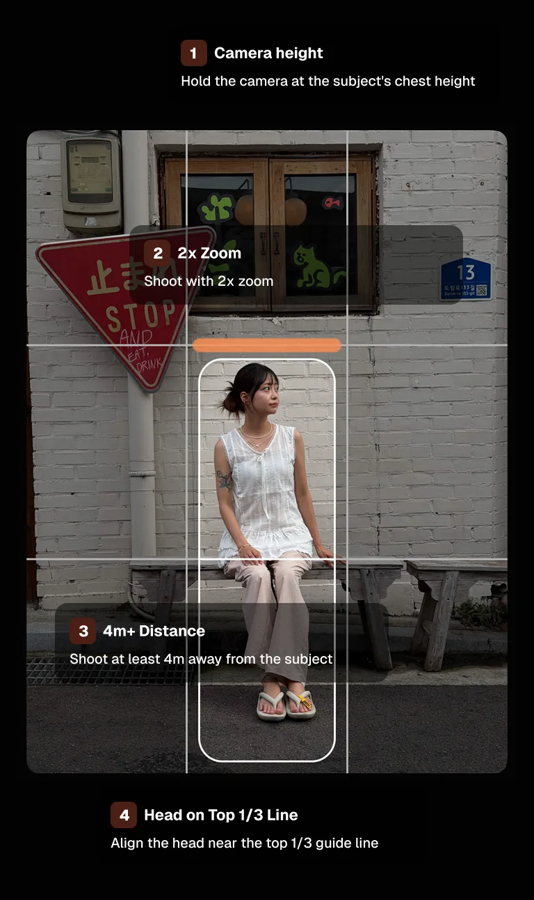
  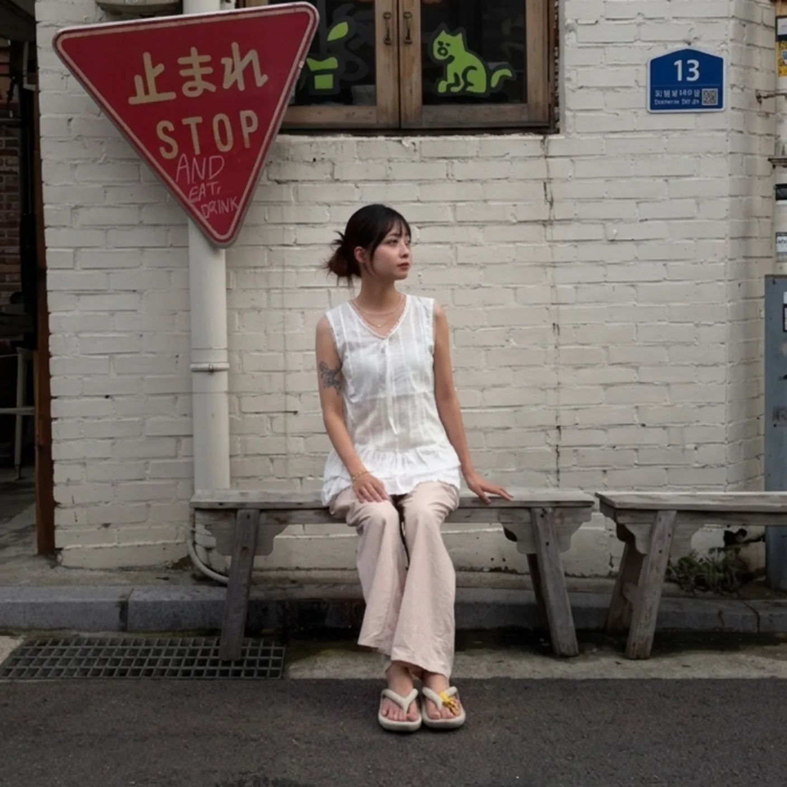
</p>

1. **Camera height** — Hold the camera at the subject's chest height.
2. **2x zoom** — Shoot with 2x zoom.
3. **4m+ distance** — Stand at least 4 metres away from the subject.
4. **Head on top 1/3 line** — Align the head near the top third guide line.

→ Full guide: [Portrait 2 on slaycamera.com](https://www.slaycamera.com/guides/portrait-2?utm_source=github&utm_medium=repo&utm_campaign=composition-guides) ·
Deep dive: [Low angle? Go dramatic. Go bold.](https://www.slaycamera.com/blog/low-angle-go-dramatic?utm_source=github&utm_medium=repo&utm_campaign=composition-guides)

### 3. Close Up: Telephoto half-body portrait

A closer, half-body portrait shot on the telephoto lens. Standing back and zooming in flattens the background and gives a flattering, magazine-style look.

<p>
  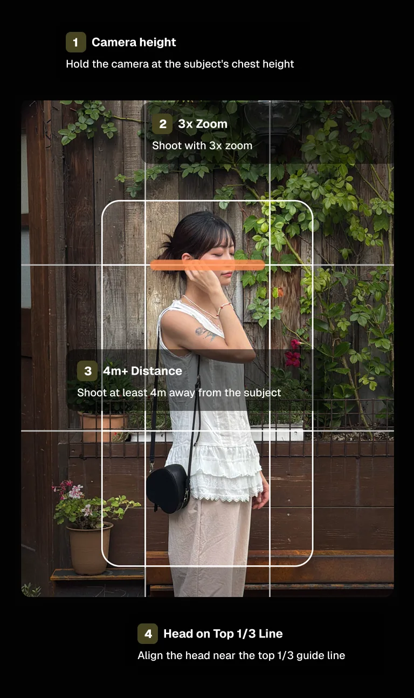
  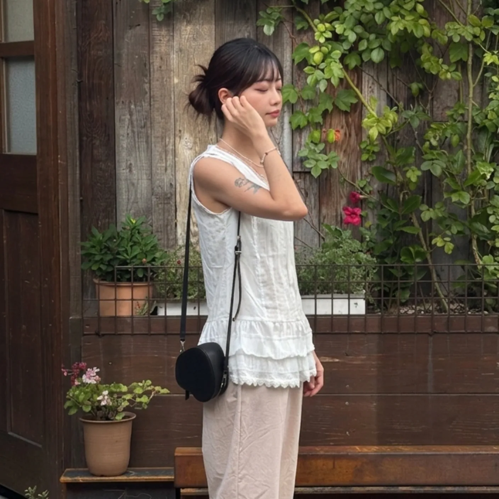
</p>

1. **Camera height** — Hold the camera at the subject's chest height.
2. **3x zoom** — Shoot with 3x zoom.
3. **4m+ distance** — Stand at least 4 metres away from the subject.
4. **Head on top 1/3 line** — Align the head near the top third guide line.

→ Full guide: [Close Up on slaycamera.com](https://www.slaycamera.com/guides/close-up?utm_source=github&utm_medium=repo&utm_campaign=composition-guides) ·
Deep dive: [Texture is emotion in close-up](https://www.slaycamera.com/blog/texture-is-emotion-in-close-up?utm_source=github&utm_medium=repo&utm_campaign=composition-guides)

### 4. Side Chick: Off-center environmental portrait

The subject sits to one side of the frame while the scene — a café table, a doorway, a street — fills the rest. It tells a story about where the person is, not just who they are.

<p>
  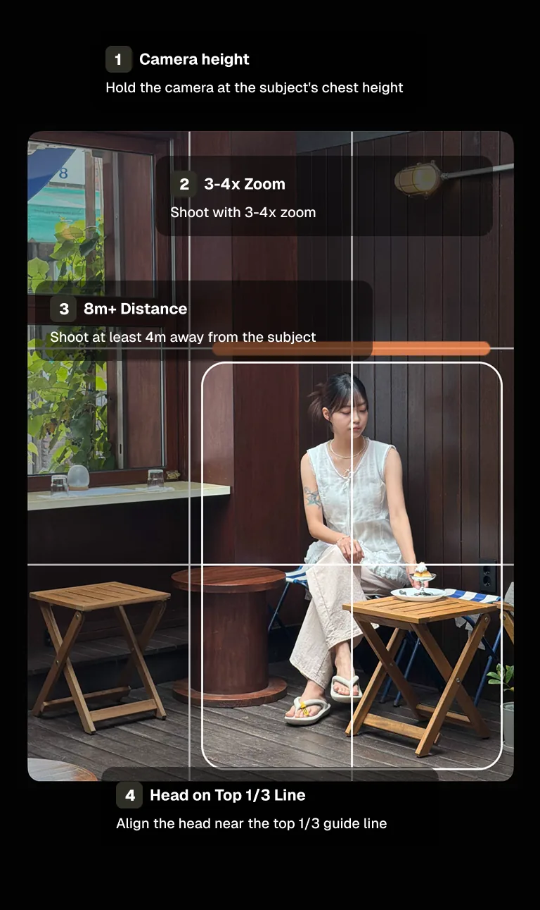
  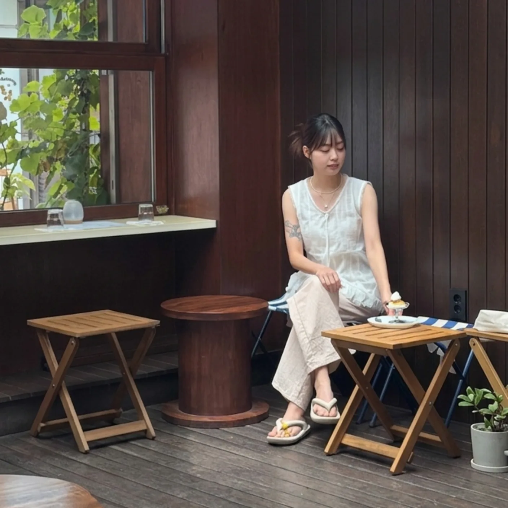
</p>

1. **Camera height** — Hold the camera at the subject's chest height.
2. **3–4x zoom** — Shoot with 3–4x zoom.
3. **8m+ distance** — Stand at least 8 metres away from the subject.
4. **Head on top 1/3 line** — Place the subject in the side box with the head near the top third line.

→ Full guide: [Side Chick on slaycamera.com](https://www.slaycamera.com/guides/side-chick?utm_source=github&utm_medium=repo&utm_campaign=composition-guides) ·
Deep dive: [Break the rule, keep the feeling](https://www.slaycamera.com/blog/break-the-rule-keep-the-feeling?utm_source=github&utm_medium=repo&utm_campaign=composition-guides)

## Travel & scenery

### 5. Travel Shot: Small subject, big scenery

The classic travel photo where the place is the star: the person is small at the bottom of the frame and the landmark or landscape fills everything above.

<p>
  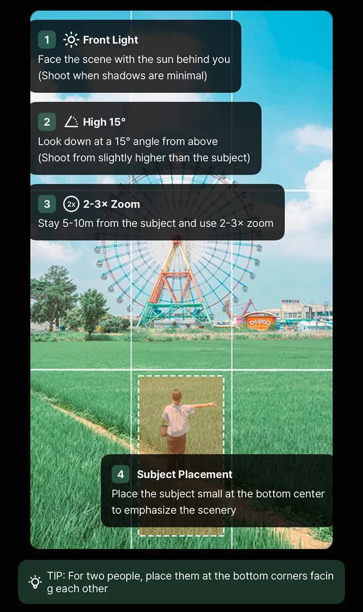
  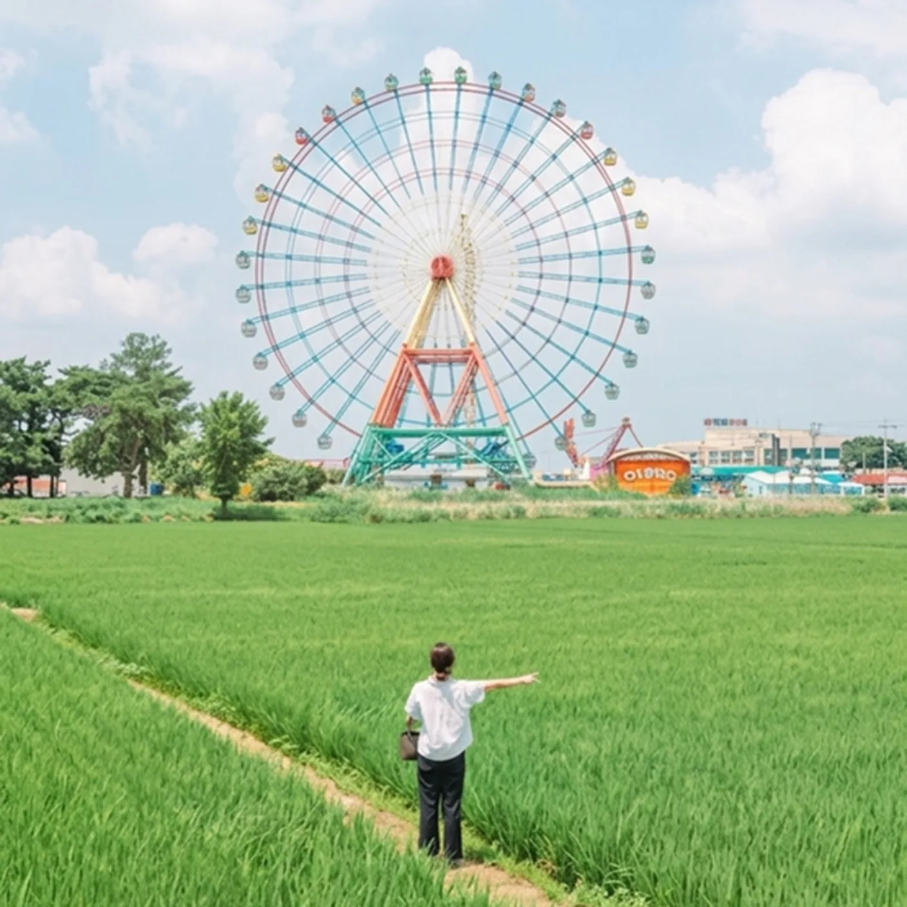
</p>

1. **Front light** — Face the scene with the sun behind you, ideally when shadows are minimal.
2. **High 15°** — Look down at a 15° angle, shooting from slightly higher than the subject.
3. **2–3x zoom** — Stay 5–10 metres from the subject and use 2–3x zoom.
4. **Subject placement** — Place the subject small at the bottom center to emphasize the scenery.

> **Tip:** For two people, place them in the bottom corners facing each other.

→ Full guide: [Travel Shot on slaycamera.com](https://www.slaycamera.com/guides/travel-shot?utm_source=github&utm_medium=repo&utm_campaign=composition-guides) ·
Deep dive: [A clean horizon keeps it calm](https://www.slaycamera.com/blog/clean-horizon-keeps-it-calm?utm_source=github&utm_medium=repo&utm_campaign=composition-guides)

### 6. One-Third: Rule of thirds — subject in the lower third

A scenery shot where the main element — a bridge, a building, a horizon — sits in one third of the frame and the sky gets the other two. Simple, airy and very Instagram.

<p>
  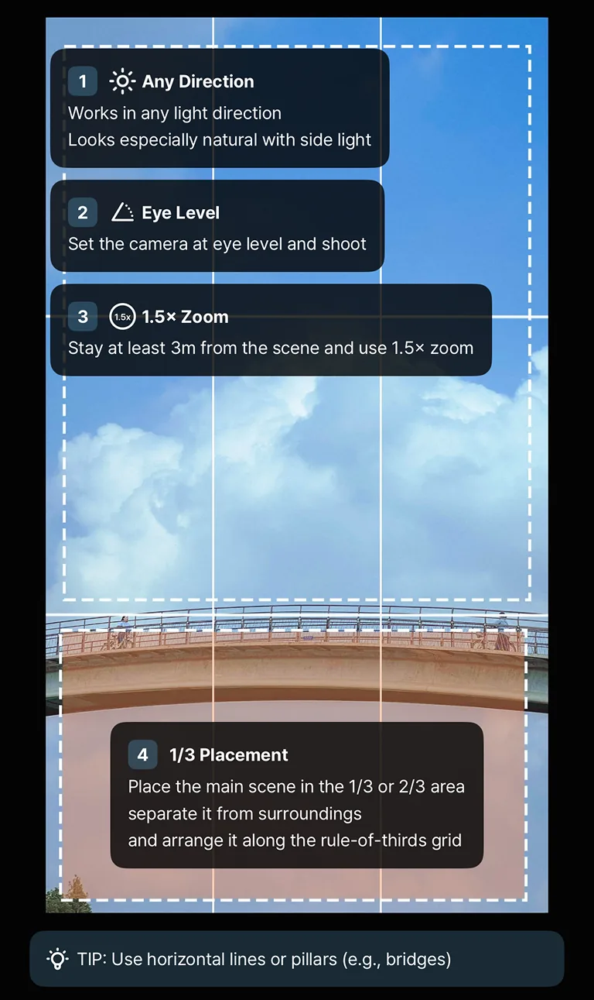
  
</p>

1. **Any direction** — Works in any light direction; looks especially natural with side light.
2. **Eye level** — Set the camera at eye level and shoot.
3. **1.5x zoom** — Stay at least 3 metres from the scene and use 1.5x zoom.
4. **1/3 placement** — Place the main scene in the 1/3 area, separate it from its surroundings and line it up with the rule-of-thirds grid.

> **Tip:** Use horizontal lines or pillars, such as bridges, to separate the areas.

→ Full guide: [One-Third on slaycamera.com](https://www.slaycamera.com/guides/one-third?utm_source=github&utm_medium=repo&utm_campaign=composition-guides) ·
Deep dive: [Rule of thirds, but let the sky breathe](https://www.slaycamera.com/blog/rule-of-thirds-let-the-sky-breathe?utm_source=github&utm_medium=repo&utm_campaign=composition-guides)

### 7. Two-Third: Rule of thirds — subject fills two-thirds

The counterpart to One-Third: the main subject — a tower, a tree, a building — fills two-thirds of the frame, with a strip of sky or ground for balance.

<p>
  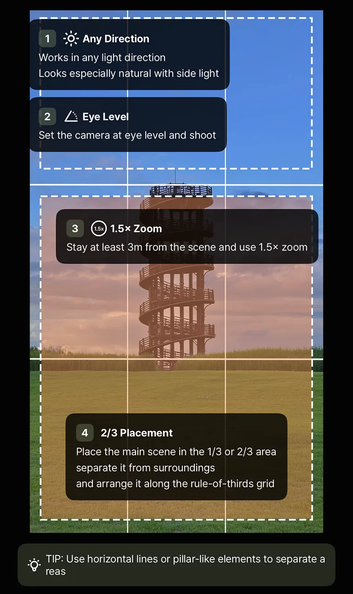
  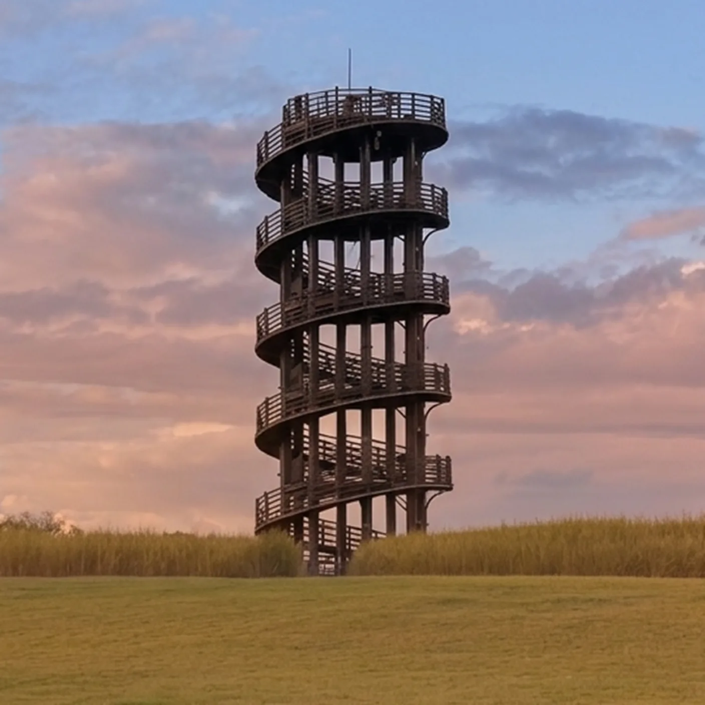
</p>

1. **Any direction** — Works in any light direction; looks especially natural with side light.
2. **Eye level** — Set the camera at eye level and shoot.
3. **1.5x zoom** — Stay at least 3 metres from the scene and use 1.5x zoom.
4. **2/3 placement** — Place the main scene in the 2/3 area, separate it from its surroundings and line it up with the rule-of-thirds grid.

> **Tip:** Use horizontal lines or pillar-like elements to separate the areas.

→ Full guide: [Two-Third on slaycamera.com](https://www.slaycamera.com/guides/two-third?utm_source=github&utm_medium=repo&utm_campaign=composition-guides) ·
Deep dive: [The 2/3 focus rule that doubles depth](https://www.slaycamera.com/blog/two-thirds-focus-rule?utm_source=github&utm_medium=repo&utm_campaign=composition-guides)

## Food & café

### 8. Vanishing Point: Corner lines converging on the subject

A café or food shot where the edges of the table run toward the subject, pulling the eye straight to it. The table corner becomes a frame within the frame.

<p>
  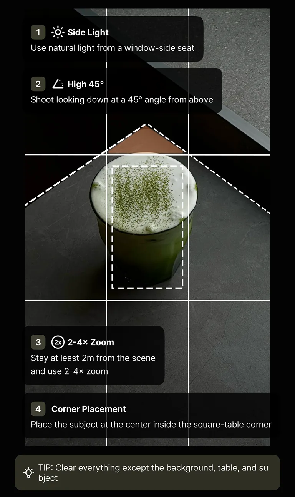
  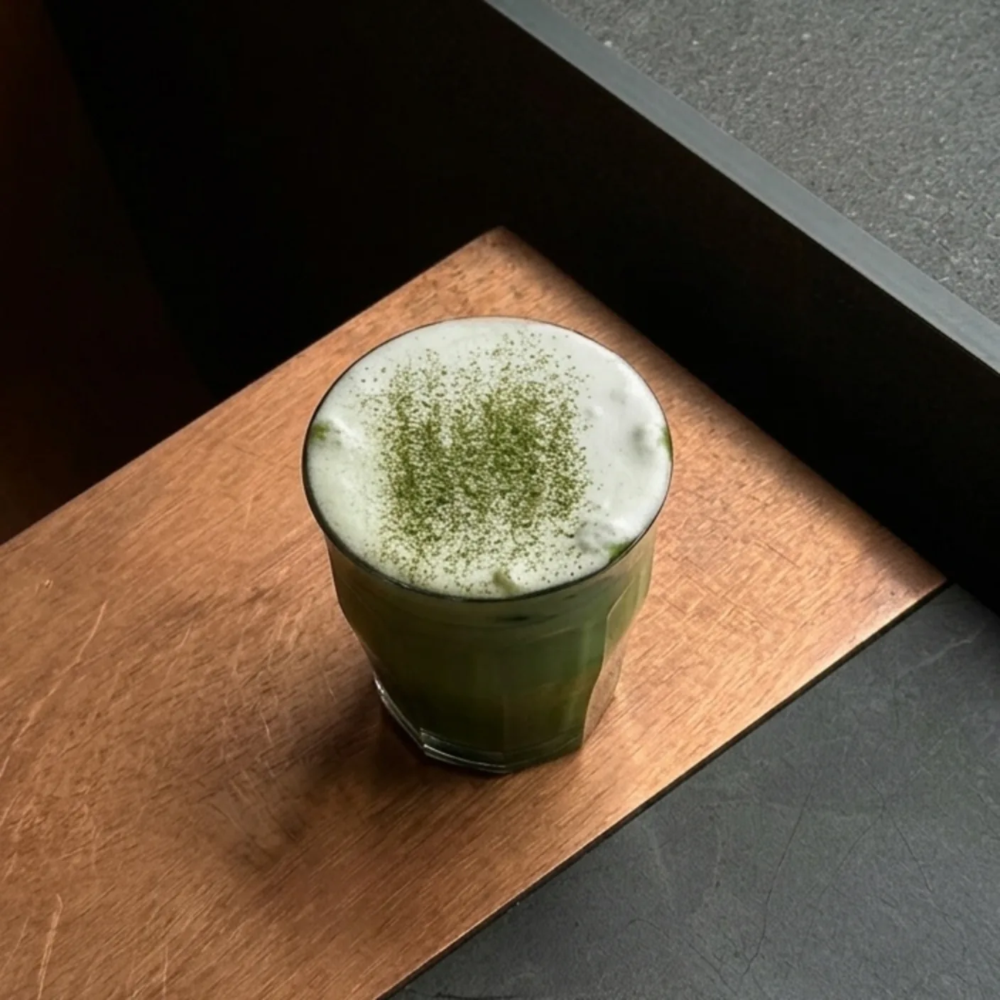
</p>

1. **Side light** — Use natural light from a window-side seat.
2. **High 45°** — Shoot looking down at a 45° angle from above.
3. **2–4x zoom** — Stay at least 2 metres from the scene and use 2–4x zoom.
4. **Corner placement** — Place the subject at the center, inside the square table corner.

> **Tip:** Clear everything except the background, the table and the subject.

→ Full guide: [Vanishing Point on slaycamera.com](https://www.slaycamera.com/guides/vanishing-point?utm_source=github&utm_medium=repo&utm_campaign=composition-guides) ·
Deep dive: [Vanishing point composition explained](https://www.slaycamera.com/blog/vanishing-point-composition-explained?utm_source=github&utm_medium=repo&utm_campaign=composition-guides)

### 9. One-Point Vertex: Single subject on a grid intersection

One subject — a drink, a dessert — sits on a grid intersection with empty space on the opposite side. The asymmetry gives depth while keeping all attention on the subject.

<p>
  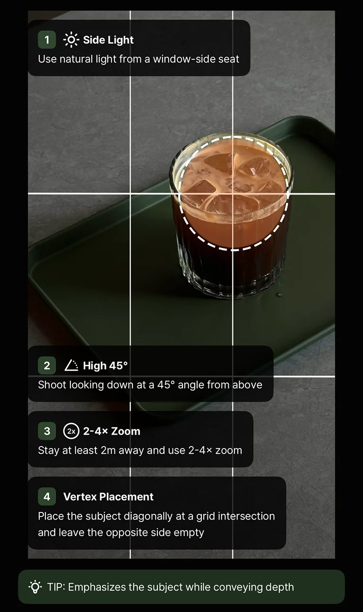
  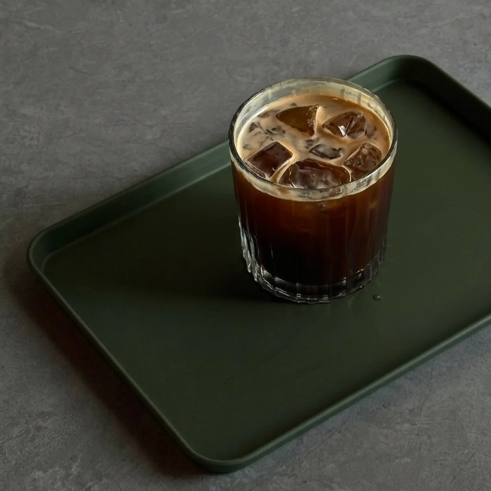
</p>

1. **Side light** — Use natural light from a window-side seat.
2. **High 45°** — Shoot looking down at a 45° angle from above.
3. **2–4x zoom** — Stay at least 2 metres away and use 2–4x zoom.
4. **Vertex placement** — Place the subject diagonally at a grid intersection and leave the opposite side empty.

> **Tip:** This emphasizes the subject while conveying depth.

→ Full guide: [One-Point Vertex on slaycamera.com](https://www.slaycamera.com/guides/one-point-vertex?utm_source=github&utm_medium=repo&utm_campaign=composition-guides) ·
Deep dive: [Find symmetry, calm the whole shot](https://www.slaycamera.com/blog/find-symmetry-calm-the-shot?utm_source=github&utm_medium=repo&utm_campaign=composition-guides)

### 10. Two-Point Vertex: Two subjects on a diagonal

Two subjects — say a drink and a pastry — sit on opposite grid intersections along a diagonal. The diagonal line between them adds energy and leads the eye across the frame.

<p>
  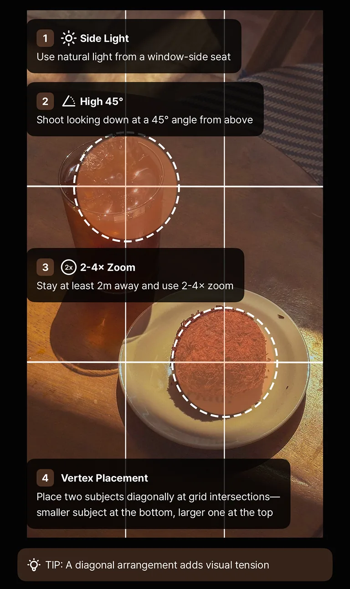
  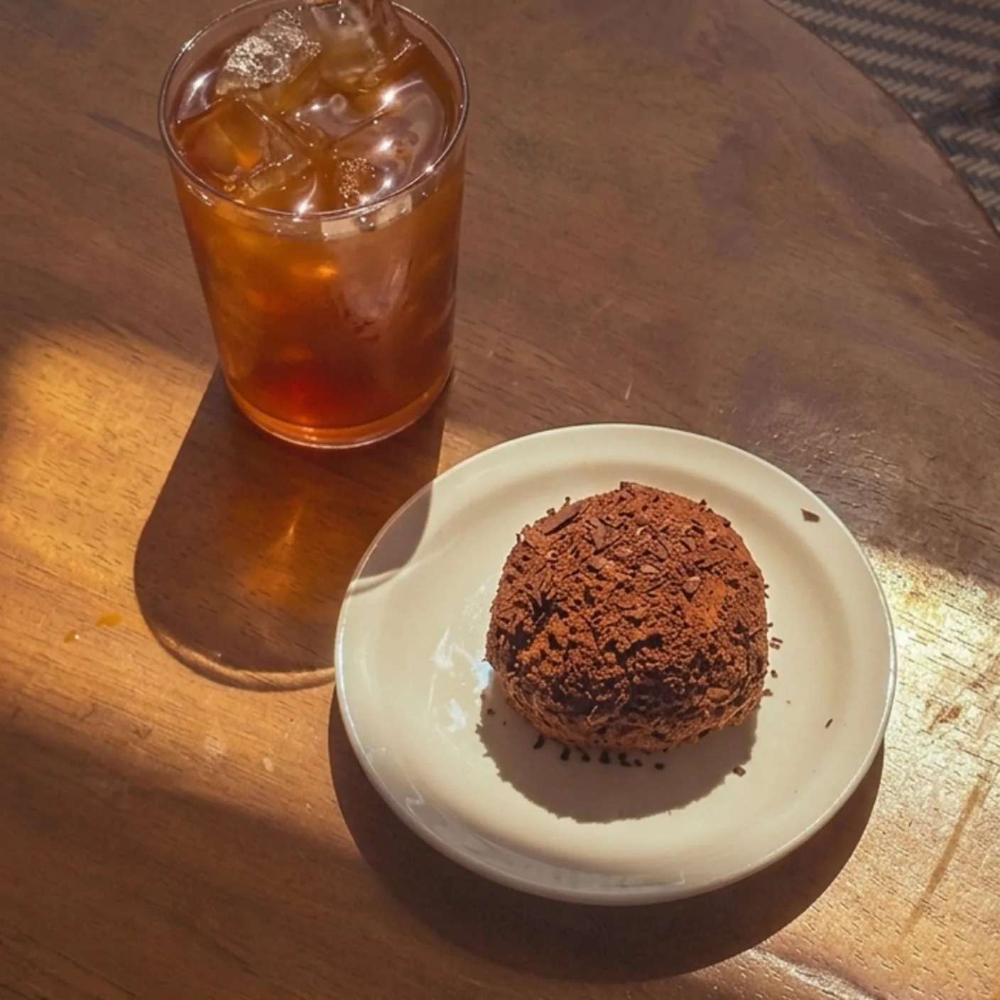
</p>

1. **Side light** — Use natural light from a window-side seat.
2. **High 45°** — Shoot looking down at a 45° angle from above.
3. **2–4x zoom** — Stay at least 2 metres away and use 2–4x zoom.
4. **Vertex placement** — Place the two subjects diagonally at grid intersections — the smaller one at the bottom, the larger one at the top.

> **Tip:** A diagonal arrangement adds visual tension.

→ Full guide: [Two-Point Vertex on slaycamera.com](https://www.slaycamera.com/guides/two-point-vertex?utm_source=github&utm_medium=repo&utm_campaign=composition-guides) ·
Deep dive: [Frame within a frame for instant depth](https://www.slaycamera.com/blog/frame-within-a-frame?utm_source=github&utm_medium=repo&utm_campaign=composition-guides)

### 11. Triangle 1: Three subjects in a triangle

Three items arranged as the points of a triangle in the lower two-thirds of the frame. Triangles are the most stable shape in composition, so a busy table still feels ordered.

<p>
  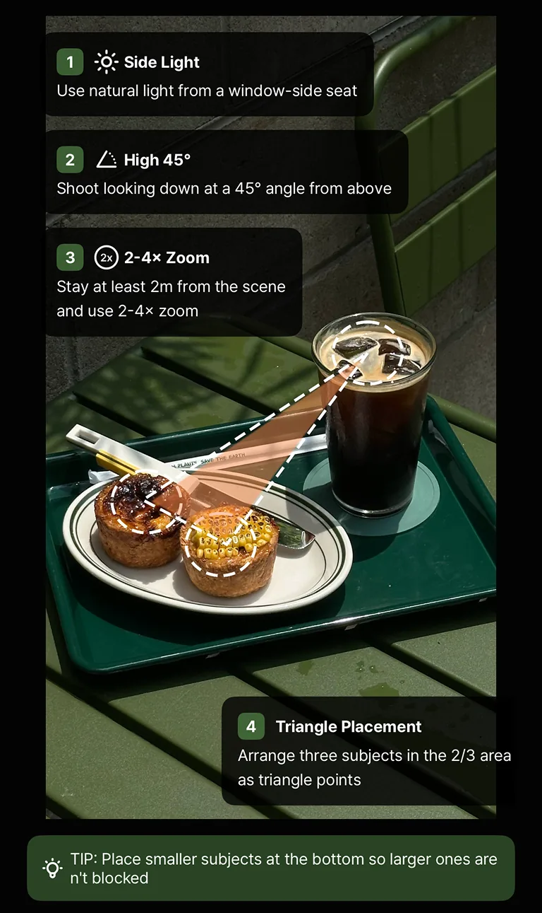
  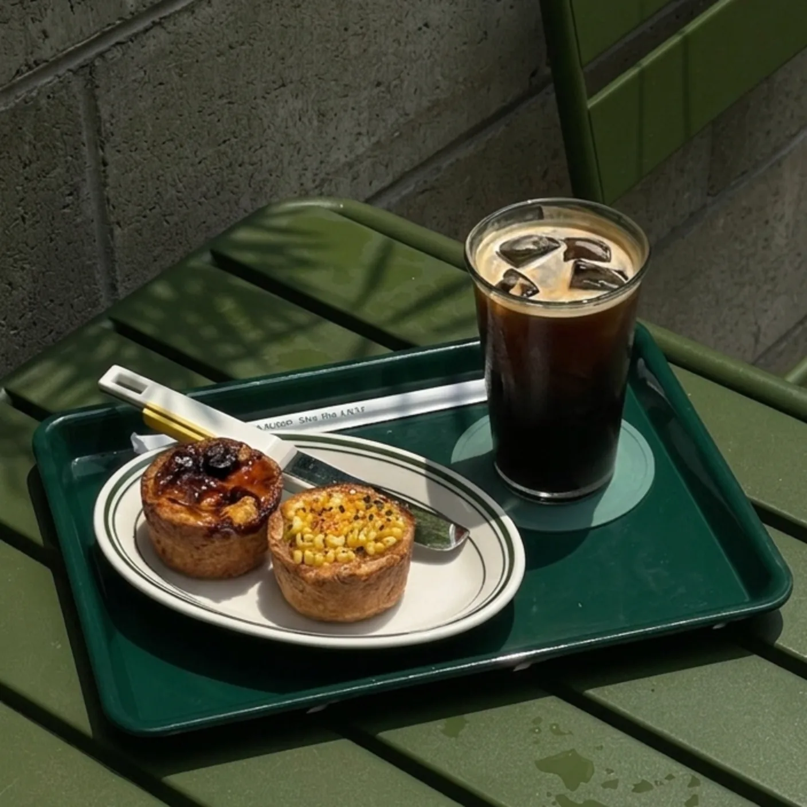
</p>

1. **Side light** — Use natural light from a window-side seat.
2. **High 45°** — Shoot looking down at a 45° angle from above.
3. **2–4x zoom** — Stay at least 2 metres from the scene and use 2–4x zoom.
4. **Triangle placement** — Arrange three subjects in the 2/3 area as the points of a triangle.

> **Tip:** Place smaller subjects at the bottom so the larger ones aren't blocked.

→ Full guide: [Triangle 1 on slaycamera.com](https://www.slaycamera.com/guides/triangle-1?utm_source=github&utm_medium=repo&utm_campaign=composition-guides) ·
Deep dive: [Layered foregrounds tell a story](https://www.slaycamera.com/blog/layered-foregrounds-tell-a-story?utm_source=github&utm_medium=repo&utm_campaign=composition-guides)

### 12. Triangle 2: Wide triangle across the frame

A wider triangle that spreads three items across the whole table — cup, glass and plate — so the frame reads as one scene with a story.

<p>
  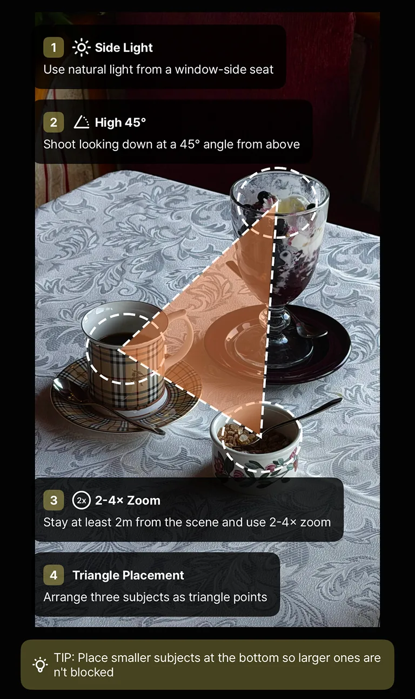
  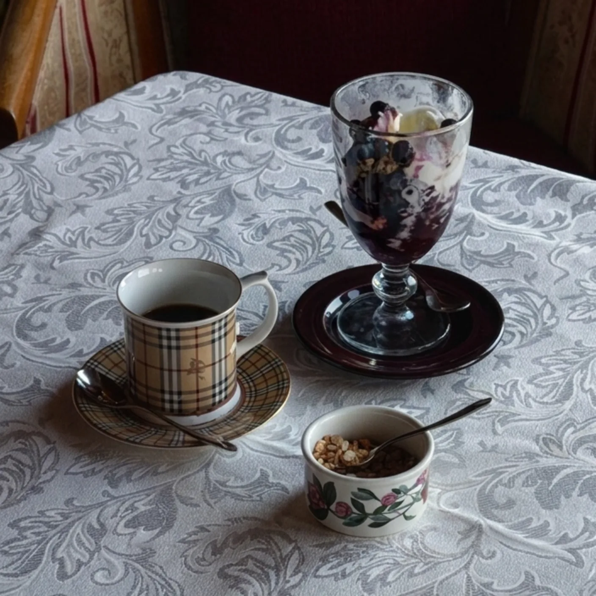
</p>

1. **Side light** — Use natural light from a window-side seat.
2. **High 45°** — Shoot looking down at a 45° angle from above.
3. **2–4x zoom** — Stay at least 2 metres from the scene and use 2–4x zoom.
4. **Triangle placement** — Arrange three subjects as the points of a triangle.

> **Tip:** Place smaller subjects at the bottom so the larger ones aren't blocked.

→ Full guide: [Triangle 2 on slaycamera.com](https://www.slaycamera.com/guides/triangle-2?utm_source=github&utm_medium=repo&utm_campaign=composition-guides) ·
Deep dive: [Tell a story in a single frame](https://www.slaycamera.com/blog/tell-a-story-single-frame?utm_source=github&utm_medium=repo&utm_campaign=composition-guides)

### 13. Aerial Triangle: Top-down flat lay, items in a triangle

A straight-down flat lay of a table, with the items arranged as triangle points in the lower two-thirds. The overhead view turns plates and glasses into clean shapes.

<p>
  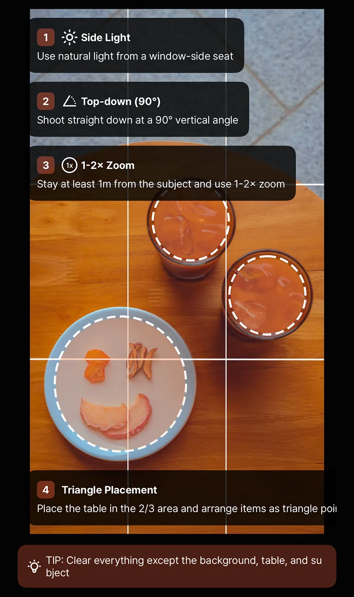
  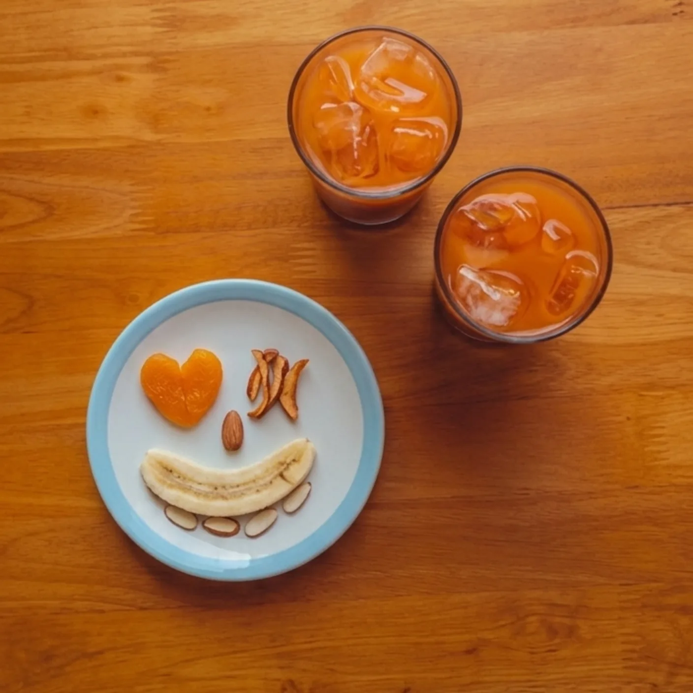
</p>

1. **Side light** — Use natural light from a window-side seat.
2. **Top-down (90°)** — Shoot straight down at a 90° vertical angle.
3. **1–2x zoom** — Stay at least 1 metre from the subject and use 1–2x zoom.
4. **Triangle placement** — Place the table in the 2/3 area and arrange the items as triangle points.

> **Tip:** Clear everything except the background, the table and the subject.

→ Full guide: [Aerial Triangle on slaycamera.com](https://www.slaycamera.com/guides/aerial-triangle?utm_source=github&utm_medium=repo&utm_campaign=composition-guides) ·
Deep dive: [Negative space is your best friend](https://www.slaycamera.com/blog/negative-space-best-friend?utm_source=github&utm_medium=repo&utm_campaign=composition-guides)

### 14. One-Point Aerial: Top-down flat lay, single hero dish

A straight-down shot of one hero dish, centered on the bottom grid line with the table filling two-thirds of the frame. Minimal, graphic and made for food accounts.

<p>
  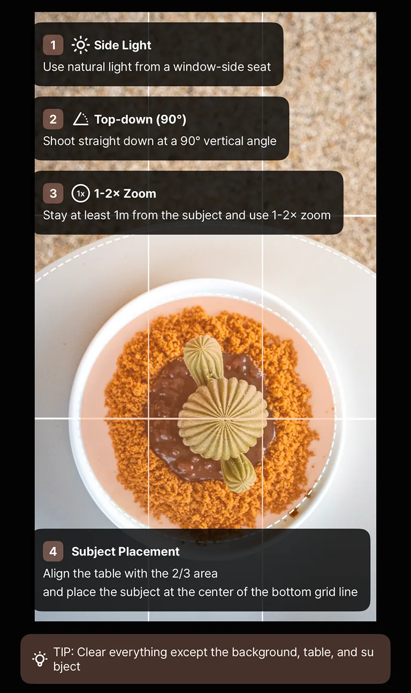
  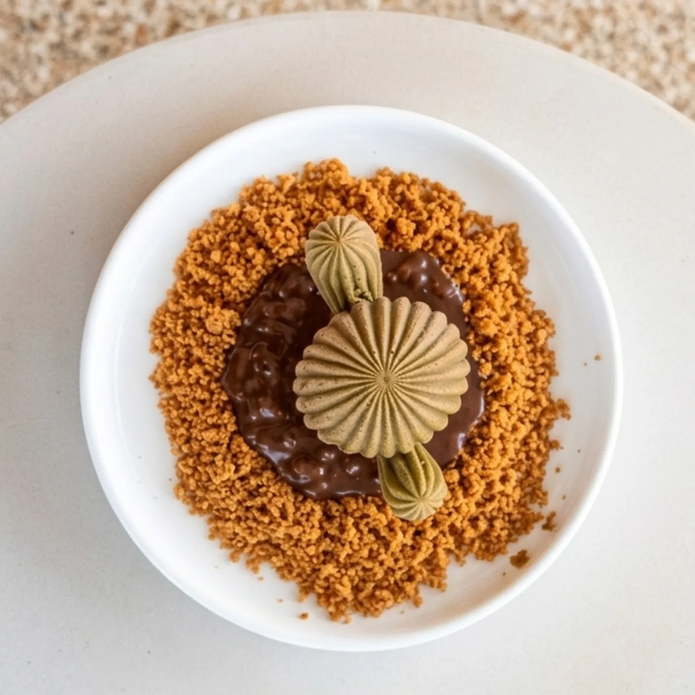
</p>

1. **Side light** — Use natural light from a window-side seat.
2. **Top-down (90°)** — Shoot straight down at a 90° vertical angle.
3. **1–2x zoom** — Stay at least 1 metre from the subject and use 1–2x zoom.
4. **Subject placement** — Align the table with the 2/3 area and place the subject at the center of the bottom grid line.

> **Tip:** Clear everything except the background, the table and the subject.

→ Full guide: [One-Point Aerial on slaycamera.com](https://www.slaycamera.com/guides/one-point-aerial?utm_source=github&utm_medium=repo&utm_campaign=composition-guides) ·
Deep dive: [Minimal color, maximum mood](https://www.slaycamera.com/blog/minimal-color-maximum-mood?utm_source=github&utm_medium=repo&utm_campaign=composition-guides)

## Use the data

`data/guides.json` holds every guide with its steps, tip, image paths and canonical URL:

```json
{
  "id": 1,
  "slug": "portrait-1",
  "name": "Portrait 1",
  "category": "Portrait",
  "principle": "Centered full-body portrait",
  "steps": [
    {
      "label": "Camera height",
      "detail": "Hold the camera at the subject's chest height."
    }
  ],
  "url": "https://www.slaycamera.com/guides/portrait-1"
}
```

`data/guides.csv` has the same guides flattened to one row each — handy for
spreadsheets, Notion or teaching handouts.

## FAQ

**What is a composition guide?**
A repeatable recipe for where to put the subject in the frame — rule of thirds,
triangles, vanishing points and so on — plus the camera settings that make it work.

**Do I need a special camera?**
No. Every guide was written for an iPhone and works with any phone or camera that has
a grid. The zoom values refer to the iPhone's 0.5x, 1x, 2x and 3x lenses.

**Can I use these in a course, video or blog post?**
Yes, including commercially. Credit slay and link to slaycamera.com (see below).

**Where can I see the guides live on my camera?**
The [slay app](https://apps.apple.com/app/id6807513456?utm_source=github&utm_medium=repo&utm_campaign=composition-guides) overlays all 14 guides on the iPhone viewfinder, tracks your
subject and locks when the shot lines up.

## Attribution

When you publish work that uses these guides, diagrams or data, add:

> Composition guides: [slay](https://www.slaycamera.com/?utm_source=github&utm_medium=repo&utm_campaign=composition-guides) (CC BY 4.0)

## License

Text, data and images in this repository are released under the
[Creative Commons Attribution 4.0 International license](LICENSE) (CC BY 4.0).

## More from slay

- [All 14 guides on slaycamera.com](https://www.slaycamera.com/guides?utm_source=github&utm_medium=repo&utm_campaign=composition-guides)
- [Photo ideas by topic](https://www.slaycamera.com/photo-ideas?utm_source=github&utm_medium=repo&utm_campaign=composition-guides)
- [Composition articles](https://www.slaycamera.com/blog?utm_source=github&utm_medium=repo&utm_campaign=composition-guides)
- [Free cinematic LUTs](https://github.com/slaycamera/luts)
- [Download slay on the App Store](https://apps.apple.com/app/id6807513456?utm_source=github&utm_medium=repo&utm_campaign=composition-guides)

## Repo layout

```
data/       guides.json and guides.csv
diagrams/   annotated diagram for each guide
examples/   example photo for each guide
CHEATSHEET.md
```
