# 摄影构图指南：14 种手机拍照实用构图方法

[](LICENSE)
[](https://www.slaycamera.com/?utm_source=github&utm_medium=repo&utm_campaign=composition-guides)

**简体中文** · [English](README.en.md) · [中文速查表](CHEATSHEET.md) · [English cheat sheet](CHEATSHEET.en.md)

这里收录了 **14 种适用于人像、旅行风景、咖啡馆与美食摄影的构图方法**。每一种都有明确的**相机高度、角度、变焦倍率、拍摄距离及主体摆放方式**，并附有构图示意图与示例照片，可以照着练习。

原始资料来自 iPhone 构图辅助相机应用 **[slay](https://www.slaycamera.com/?utm_source=github&utm_medium=repo&utm_campaign=composition-guides)**。本分支提供简体中文翻译，原始图片和数据的作者及授权信息保持不变。项目遵循 [CC BY 4.0](LICENSE)，转载时请注明原作者、许可证及翻译修改。

```bash
git clone -b i18n/zh-CN https://github.com/969981/composition-guides.git
```

> **使用提示：** 原版示意图中的英文标注暂时保留，本文提供了对应的中文拍摄步骤。文中的 1.5×、2×、3× 等变焦倍率来自原版 iPhone 指南，其他手机或相机可以根据实际镜头配置选择相近焦段。

## 14 种构图方法一览

| # | 构图方法 | 适用题材 | 构图原理 | 快速设置 |
|---|---|---|---|---|
| 1 | [居中全身人像](#guide-1) | 人像摄影 | 人物居中、完整呈现全身 | 距离约 4 米，使用 1.5 倍变焦，将头部放在画面中央。 |
| 2 | [三分法人像](#guide-2) | 人像摄影 | 人物头部靠近上方三分线 | 头部放在上方三分线上，使用 2 倍变焦。 |
| 3 | [长焦半身特写](#guide-3) | 人像摄影 | 使用长焦拍摄半身人像 | 在较远距离使用 3 倍变焦拍摄半身照，让背景更简洁。 |
| 4 | [偏侧环境人像](#guide-4) | 人像摄影 | 人物偏侧、利用环境叙事 | 用 3–4 倍变焦让人物偏离中心，借环境讲故事。 |
| 5 | [旅行小人像](#guide-5) | 旅行与风景 | 人物小、风景大 | 人物放在画面下方，大片风景留在上方。 |
| 6 | [下方三分之一构图](#guide-6) | 旅行与风景 | 主体占下方三分之一 | 主景约占画面三分之一，天空占另外三分之二。 |
| 7 | [三分之二主体构图](#guide-7) | 旅行与风景 | 主体占画面三分之二 | 主体占据画面约三分之二，留出天空或地面作平衡。 |
| 8 | [消失点构图](#guide-8) | 美食与咖啡馆 | 桌角线条汇聚到主体 | 利用桌面边缘的汇聚线，把视线引向咖啡或美食。 |
| 9 | [单交点构图](#guide-9) | 美食与咖啡馆 | 单个主体置于网格交点 | 将单个主体放在网格交点，另一侧适当留白。 |
| 10 | [双交点对角线构图](#guide-10) | 美食与咖啡馆 | 两个主体沿对角线排列 | 两个主体沿对角线分布：小的在下，大的在上。 |
| 11 | [三角形构图一](#guide-11) | 美食与咖啡馆 | 三个主体组成三角形 | 在画面下方三分之二区域，将三个物件排成三角形。 |
| 12 | [三角形构图二](#guide-12) | 美食与咖啡馆 | 宽三角形横跨画面 | 三个物件横跨整张桌面，组成跨度较大的三角形。 |
| 13 | [俯拍三角形构图](#guide-13) | 美食与咖啡馆 | 垂直俯拍、静物呈三角形 | 从正上方俯拍，把桌上物件排列成三角形。 |
| 14 | [俯拍单主体构图](#guide-14) | 美食与咖啡馆 | 垂直俯拍、突出一道主菜 | 从正上方俯拍，将主菜放在画面下方网格线上。 |

需要边拍边看？打开 [中文一页速查表](CHEATSHEET.md)。

## 人像摄影

<a id="guide-1"></a>

### 1. 居中全身人像：人物居中、完整呈现全身

让人物站在画面中央，拍摄完整的全身人像，同时保留周围环境。居中构图平稳、自信，适当拉开距离还能完整展示穿搭。

<p>
  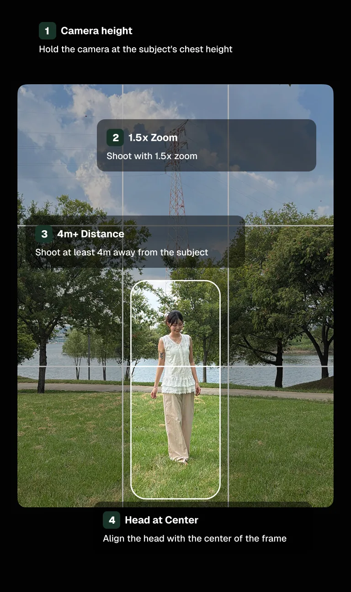
  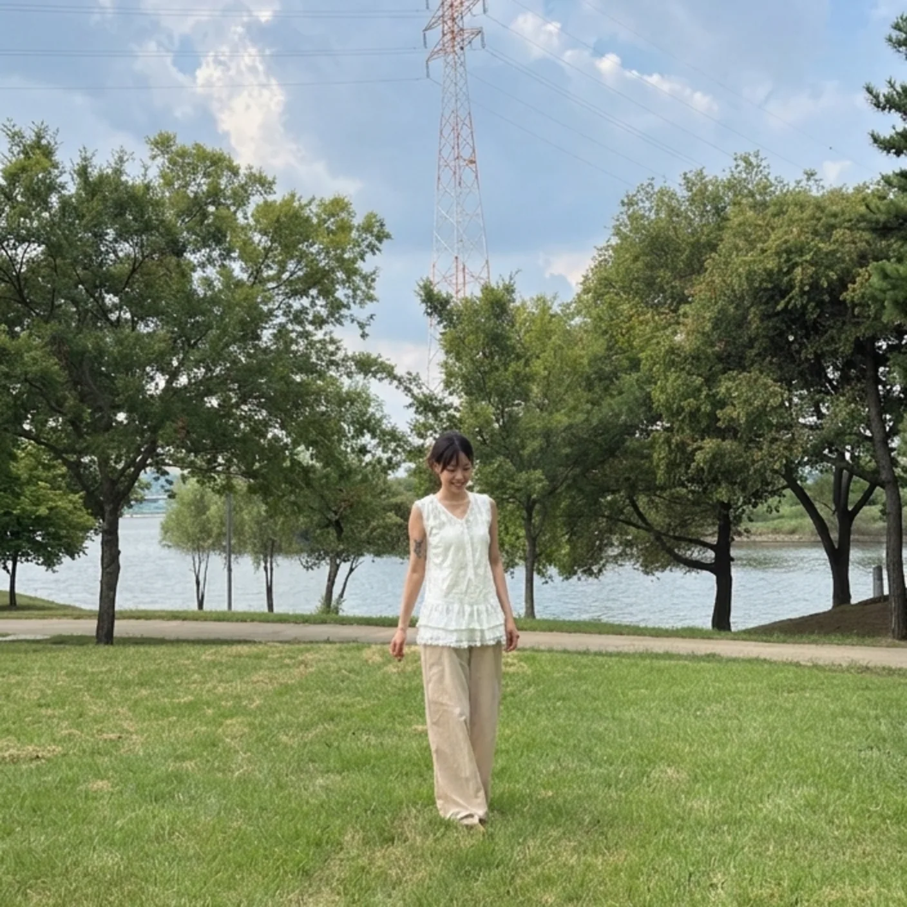
</p>

1. **相机高度** — 将相机保持在被摄者胸口的高度。
2. **1.5 倍变焦** — 使用 1.5 倍变焦，保持自然的人物比例。
3. **距离至少 4 米** — 拍摄者与人物至少相距 4 米。
4. **头部居中** — 将人物头部对准画面中央。

原版参考：[slay 构图详解](https://www.slaycamera.com/guides/portrait-1) · [相关摄影文章](https://www.slaycamera.com/blog/center-subject-own-the-frame)

<a id="guide-2"></a>

### 2. 三分法人像：人物头部靠近上方三分线

适用于全身或坐姿人像：让人物头部靠近上方三分线。相较于居中全身照，人物在画面中占比更大，但仍能交代周围环境。

<p>
  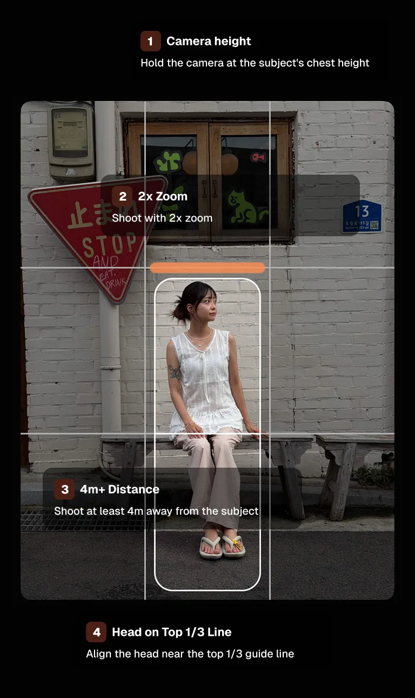
  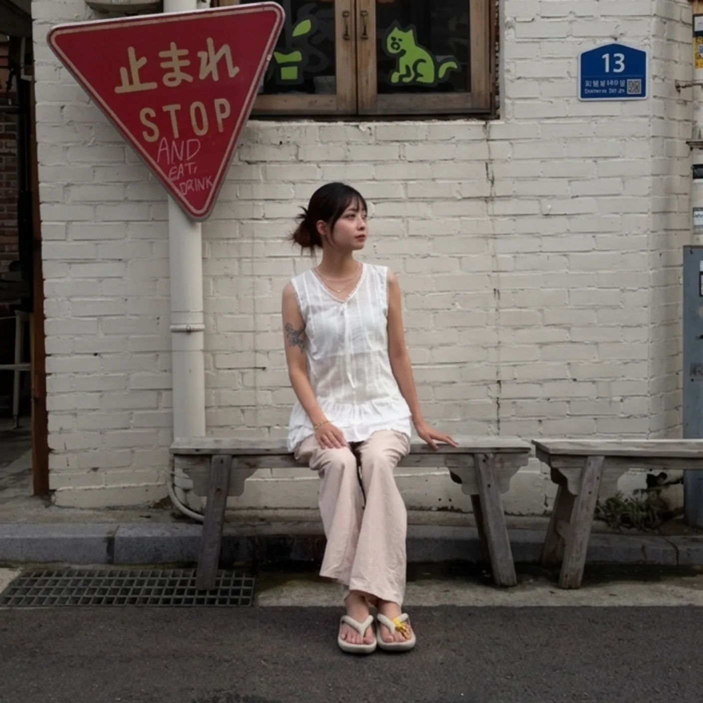
</p>

1. **相机高度** — 将相机保持在被摄者胸口的高度。
2. **2 倍变焦** — 使用 2 倍变焦拍摄。
3. **距离至少 4 米** — 拍摄者与人物至少相距 4 米。
4. **头部对齐上三分线** — 将头部放在靠近上方三分线的位置。

原版参考：[slay 构图详解](https://www.slaycamera.com/guides/portrait-2) · [相关摄影文章](https://www.slaycamera.com/blog/low-angle-go-dramatic)

<a id="guide-3"></a>

### 3. 长焦半身特写：使用长焦拍摄半身人像

使用长焦镜头拍摄半身人像。先后退、再拉近画面，可以减轻近距离广角透视的夸张感，使背景看起来更紧凑，营造杂志风格。

<p>
  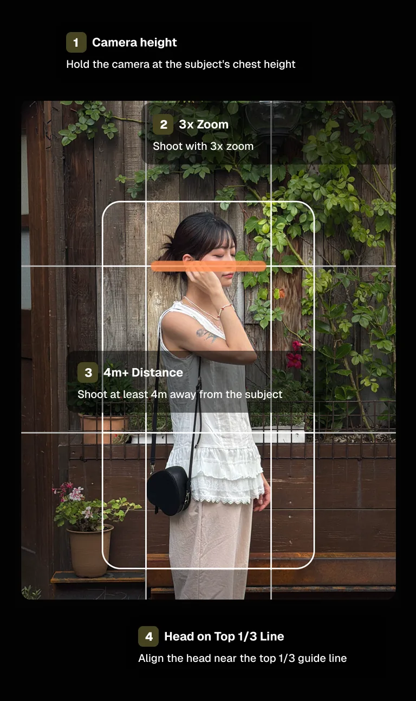
  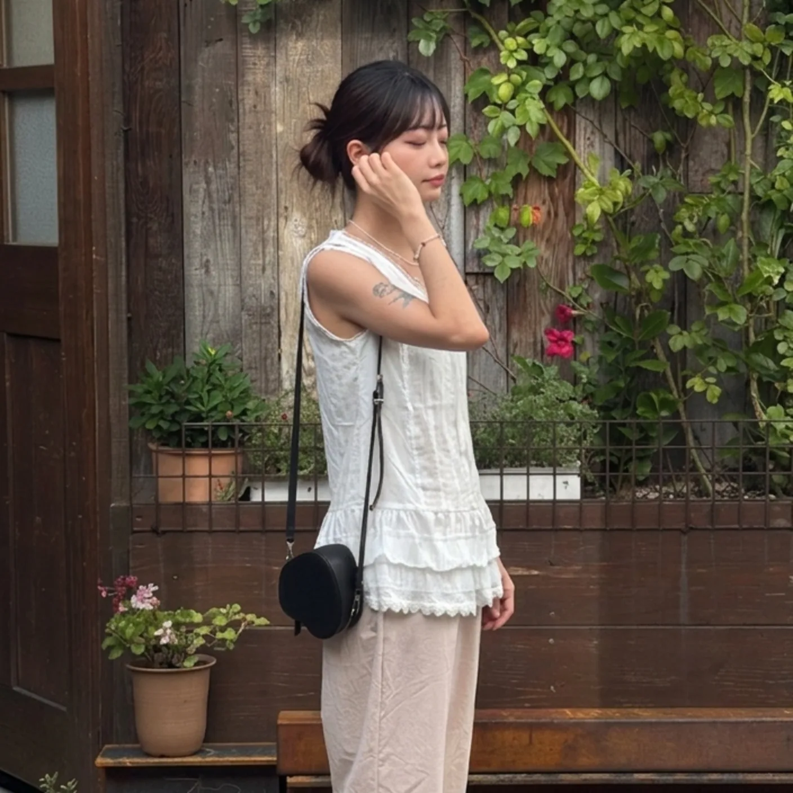
</p>

1. **相机高度** — 将相机保持在被摄者胸口的高度。
2. **3 倍变焦** — 使用 3 倍变焦拍摄。
3. **距离至少 4 米** — 拍摄者与人物至少相距 4 米。
4. **头部对齐上三分线** — 将头部放在靠近上方三分线的位置。

原版参考：[slay 构图详解](https://www.slaycamera.com/guides/close-up) · [相关摄影文章](https://www.slaycamera.com/blog/texture-is-emotion-in-close-up)

<a id="guide-4"></a>

### 4. 偏侧环境人像：人物偏侧、利用环境叙事

让人物位于画面一侧，将其余空间留给咖啡馆桌面、门廊或街道等环境。这样不仅能表现人物，还能传达人物身处的场景和氛围。

<p>
  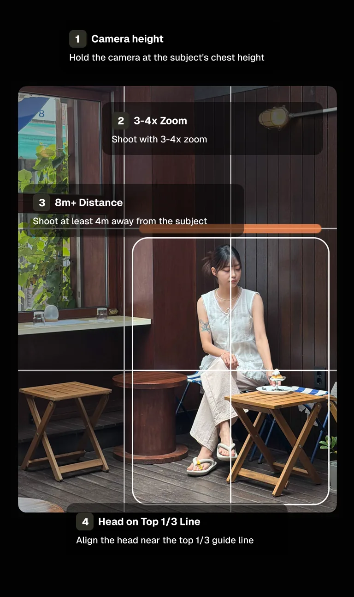
  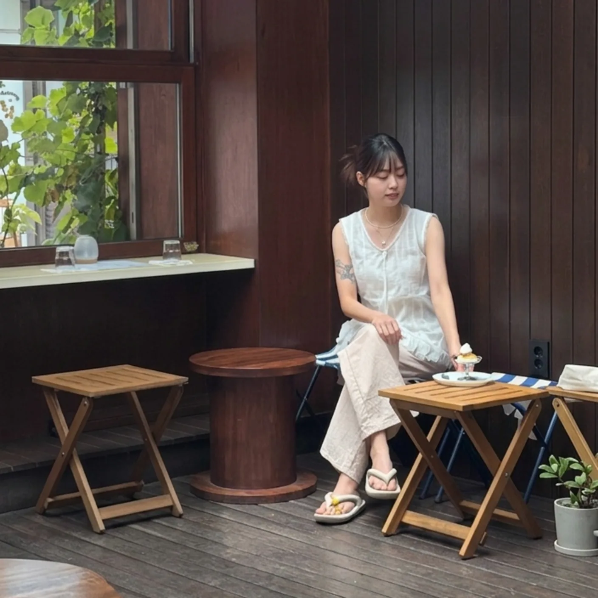
</p>

1. **相机高度** — 将相机保持在被摄者胸口的高度。
2. **3–4 倍变焦** — 使用 3–4 倍变焦拍摄。
3. **距离至少 8 米** — 拍摄者与人物至少相距 8 米。
4. **头部靠近上三分线** — 把人物放在侧边区域，头部靠近上方三分线。

原版参考：[slay 构图详解](https://www.slaycamera.com/guides/side-chick) · [相关摄影文章](https://www.slaycamera.com/blog/break-the-rule-keep-the-feeling)

## 旅行与风景

<a id="guide-5"></a>

### 5. 旅行小人像：人物小、风景大

经典旅行照以目的地为主角：人物在画面底部显得较小，地标或自然风景占据上方的大部分空间。

<p>
  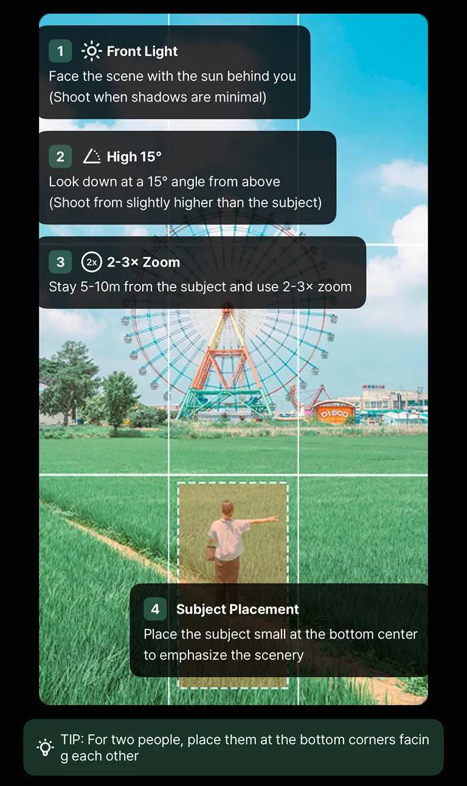
  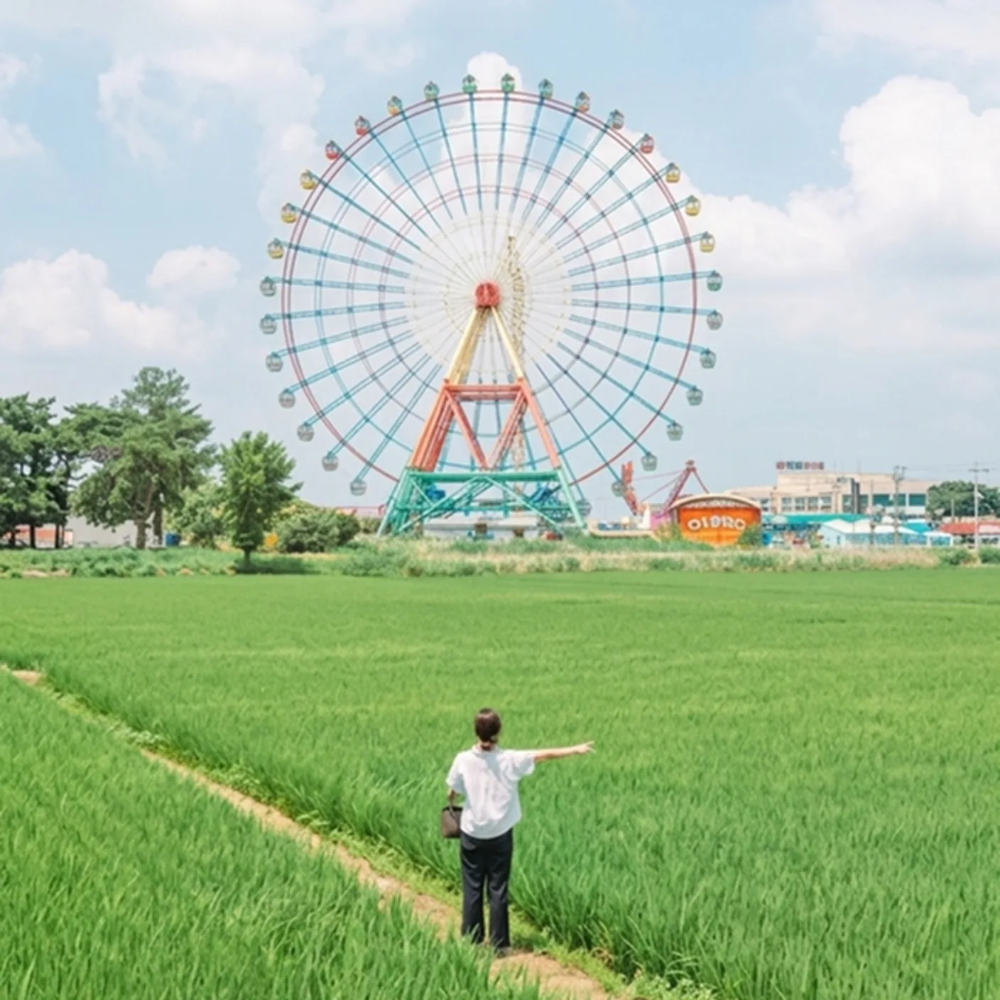
</p>

1. **顺光** — 尽量让太阳位于拍摄者身后，选择阴影较少的光线条件。
2. **稍高机位、俯拍 15°** — 相机稍高于人物，向下倾斜约 15° 拍摄。
3. **2–3 倍变焦** — 与人物保持约 5–10 米距离，使用 2–3 倍变焦。
4. **人物位置** — 将人物较小地安排在画面下方中央，突出风景。

> **小贴士：** 拍摄两人时，可把两人分别放在画面底部两侧，让他们相向而立。

原版参考：[slay 构图详解](https://www.slaycamera.com/guides/travel-shot) · [相关摄影文章](https://www.slaycamera.com/blog/clean-horizon-keeps-it-calm)

<a id="guide-6"></a>

### 6. 下方三分之一构图：主体占下方三分之一

让桥梁、建筑、地平线等主要景物位于画面三分之一区域，让天空占据其余三分之二。照片会显得简洁、通透，适合拍摄清爽的风景。

<p>
  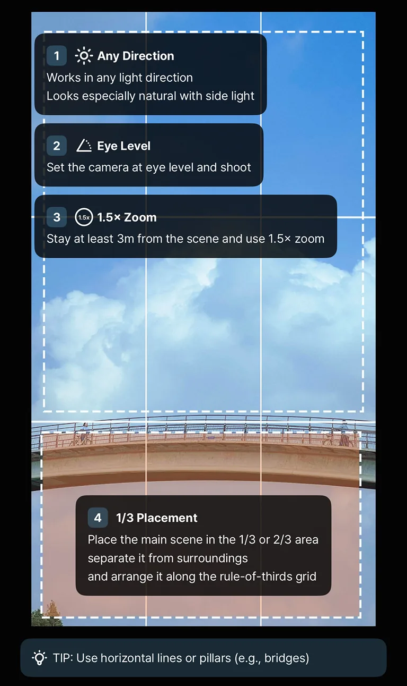
  
</p>

1. **光线方向不限** — 各种光线方向均适用，侧光通常更自然。
2. **平视机位** — 将相机放在眼睛高度拍摄。
3. **1.5 倍变焦** — 与景物至少保持 3 米距离，使用 1.5 倍变焦。
4. **三分之一位置** — 让主体景物位于画面三分之一区域，与三分法网格线对齐，并明确划分主体和周围空间。

> **小贴士：** 利用桥梁等水平线或立柱，将画面分隔为不同区域。

原版参考：[slay 构图详解](https://www.slaycamera.com/guides/one-third) · [相关摄影文章](https://www.slaycamera.com/blog/rule-of-thirds-let-the-sky-breathe)

<a id="guide-7"></a>

### 7. 三分之二主体构图：主体占画面三分之二

与下方三分之一构图相对：让高塔、树木、建筑等主体占据画面约三分之二，只保留少量天空或地面形成平衡。

<p>
  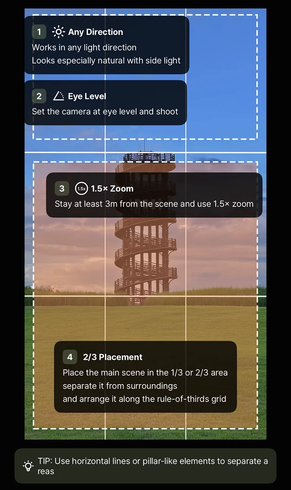
  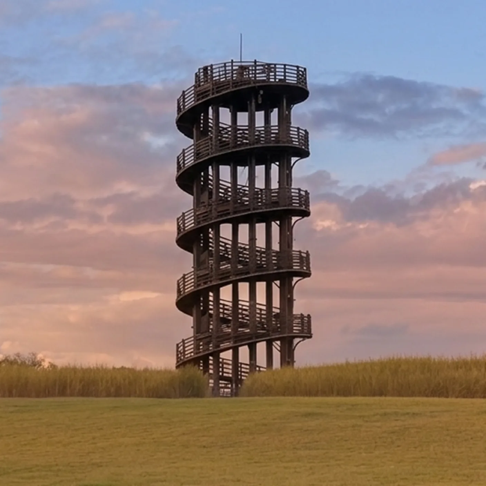
</p>

1. **光线方向不限** — 各种光线方向均适用，侧光通常更自然。
2. **平视机位** — 将相机放在眼睛高度拍摄。
3. **1.5 倍变焦** — 与景物至少保持 3 米距离，使用 1.5 倍变焦。
4. **三分之二位置** — 让主体景物位于画面三分之二区域，与三分法网格线对齐，并明确划分主体和周围空间。

> **小贴士：** 利用水平线或柱状元素来分隔画面。

原版参考：[slay 构图详解](https://www.slaycamera.com/guides/two-third) · [相关摄影文章](https://www.slaycamera.com/blog/two-thirds-focus-rule)

## 美食与咖啡馆

<a id="guide-8"></a>

### 8. 消失点构图：桌角线条汇聚到主体

在咖啡馆或美食场景中，让桌子边缘线条朝主体汇聚，引导观众视线。桌角还能在照片中形成一个天然的取景框。

<p>
  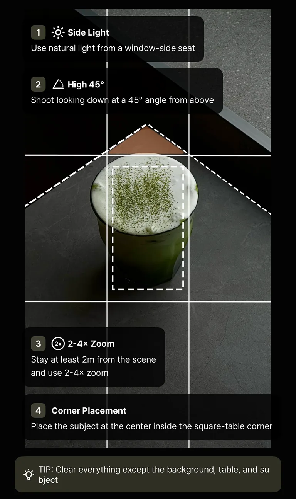
  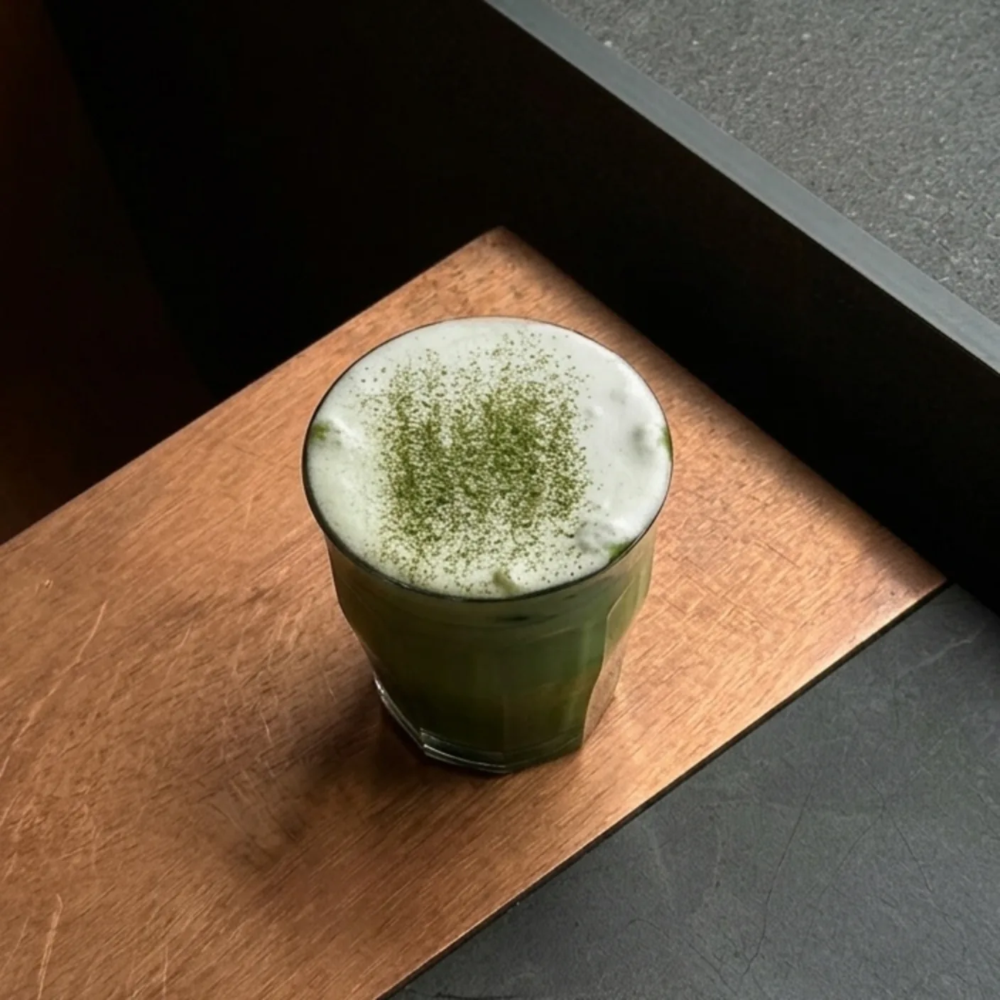
</p>

1. **侧光** — 优先利用靠窗座位的自然光。
2. **俯拍 45°** — 从上方向下倾斜约 45° 拍摄。
3. **2–4 倍变焦** — 与场景至少保持 2 米距离，使用 2–4 倍变焦。
4. **桌角位置** — 将主体放在画面中央、方形桌角包围的区域内。

> **小贴士：** 移走无关杂物，只保留背景、桌面和拍摄主体。

原版参考：[slay 构图详解](https://www.slaycamera.com/guides/vanishing-point) · [相关摄影文章](https://www.slaycamera.com/blog/vanishing-point-composition-explained)

<a id="guide-9"></a>

### 9. 单交点构图：单个主体置于网格交点

把饮品或甜点等单个主体放在三分法网格的交点上，对侧留出空间。非对称布局既能营造纵深，也让注意力集中在主体上。

<p>
  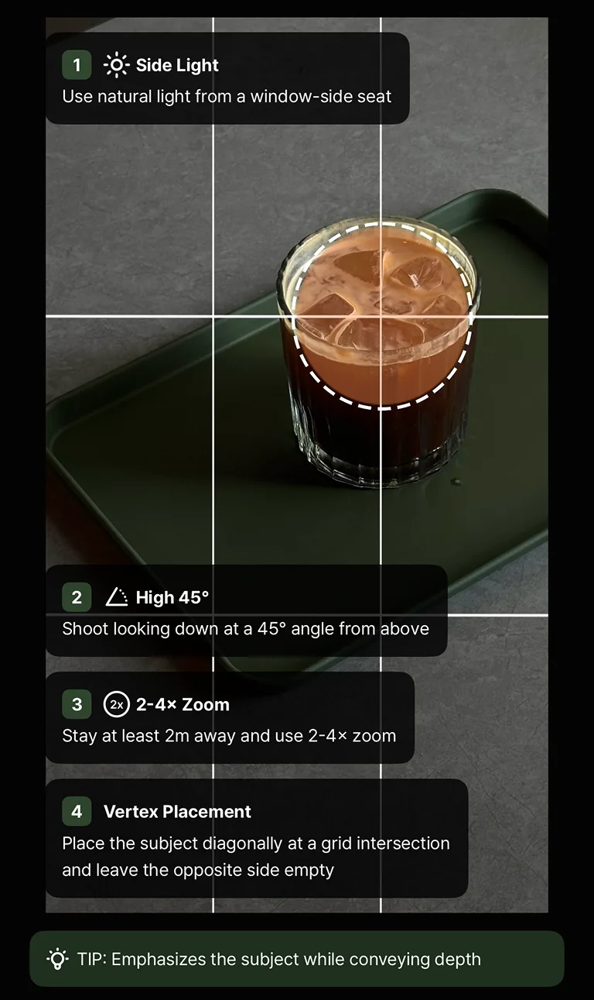
  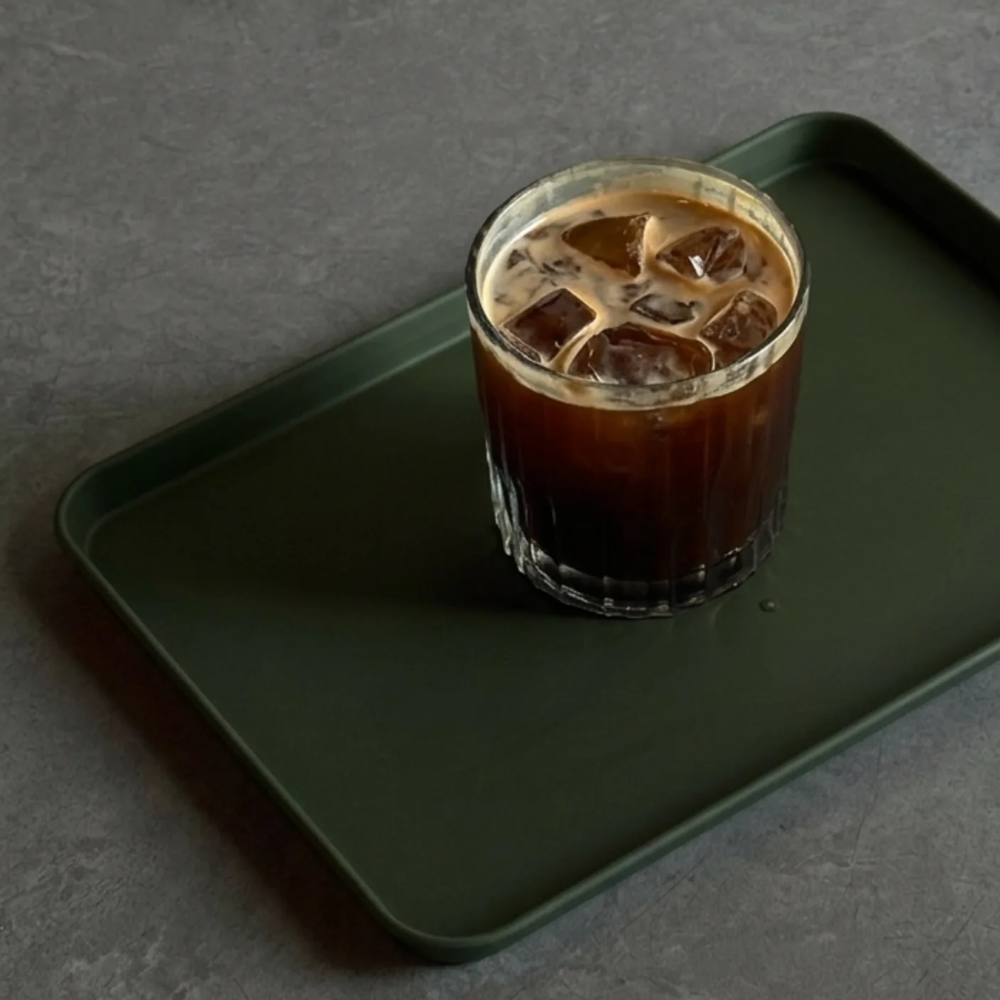
</p>

1. **侧光** — 优先利用靠窗座位的自然光。
2. **俯拍 45°** — 从上方向下倾斜约 45° 拍摄。
3. **2–4 倍变焦** — 与主体至少保持 2 米距离，使用 2–4 倍变焦。
4. **交点位置** — 沿对角线将主体放在一个网格交点，对面区域留白。

> **小贴士：** 这样既能突出主体，也能传达空间纵深感。

原版参考：[slay 构图详解](https://www.slaycamera.com/guides/one-point-vertex) · [相关摄影文章](https://www.slaycamera.com/blog/find-symmetry-calm-the-shot)

<a id="guide-10"></a>

### 10. 双交点对角线构图：两个主体沿对角线排列

把饮品、糕点等两个主体分别放在对角线两端的网格交点上。它们之间的斜线能增强画面动感，并引导视线穿过画面。

<p>
  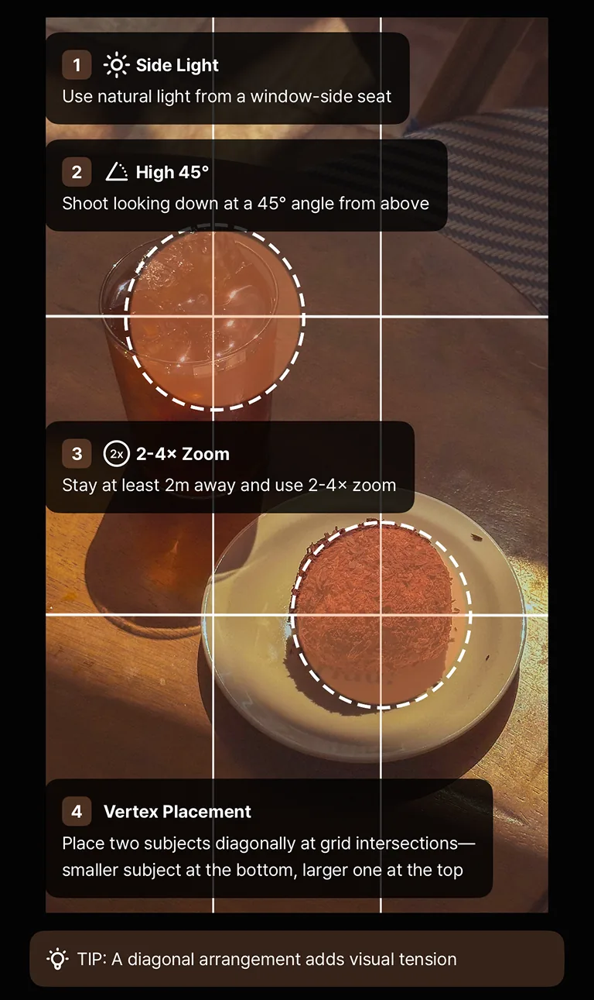
  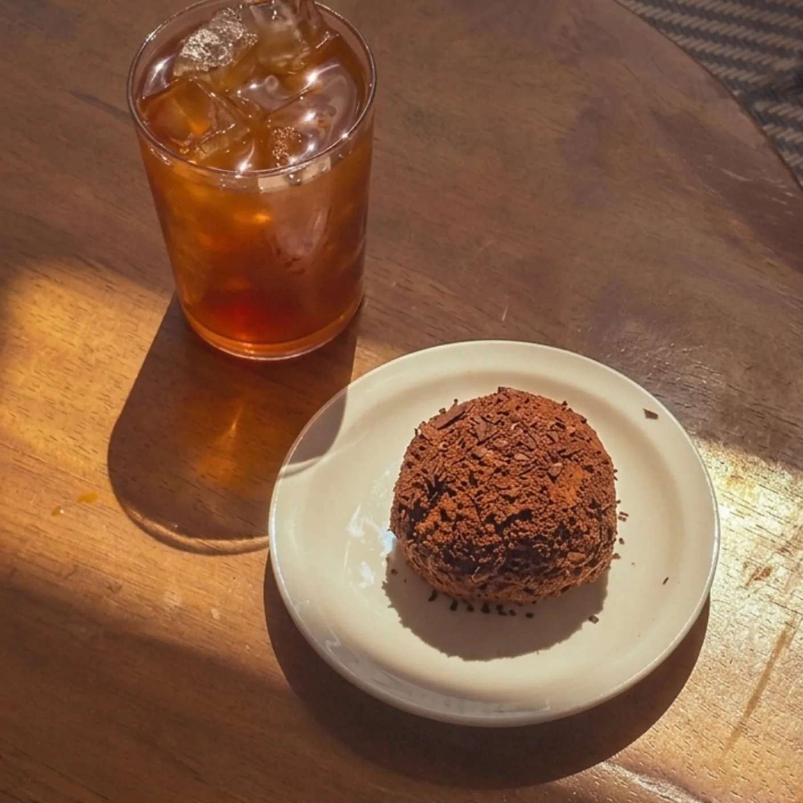
</p>

1. **侧光** — 优先利用靠窗座位的自然光。
2. **俯拍 45°** — 从上方向下倾斜约 45° 拍摄。
3. **2–4 倍变焦** — 与主体至少保持 2 米距离，使用 2–4 倍变焦。
4. **对角交点** — 将两个主体沿对角线放在网格交点，小主体位于下方，大主体位于上方。

> **小贴士：** 对角线布局能增加视觉张力。

原版参考：[slay 构图详解](https://www.slaycamera.com/guides/two-point-vertex) · [相关摄影文章](https://www.slaycamera.com/blog/frame-within-a-frame)

<a id="guide-11"></a>

### 11. 三角形构图一：三个主体组成三角形

在画面下方三分之二区域，让三个物件分别占据三角形的三个顶点。三角形构图稳定，即使桌面元素较多也能显得有序。

<p>
  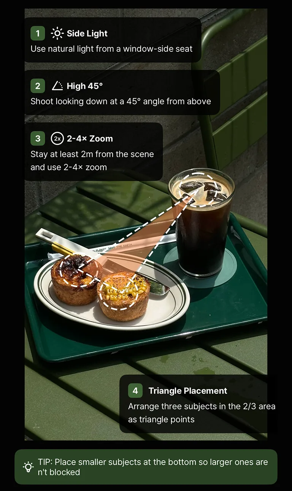
  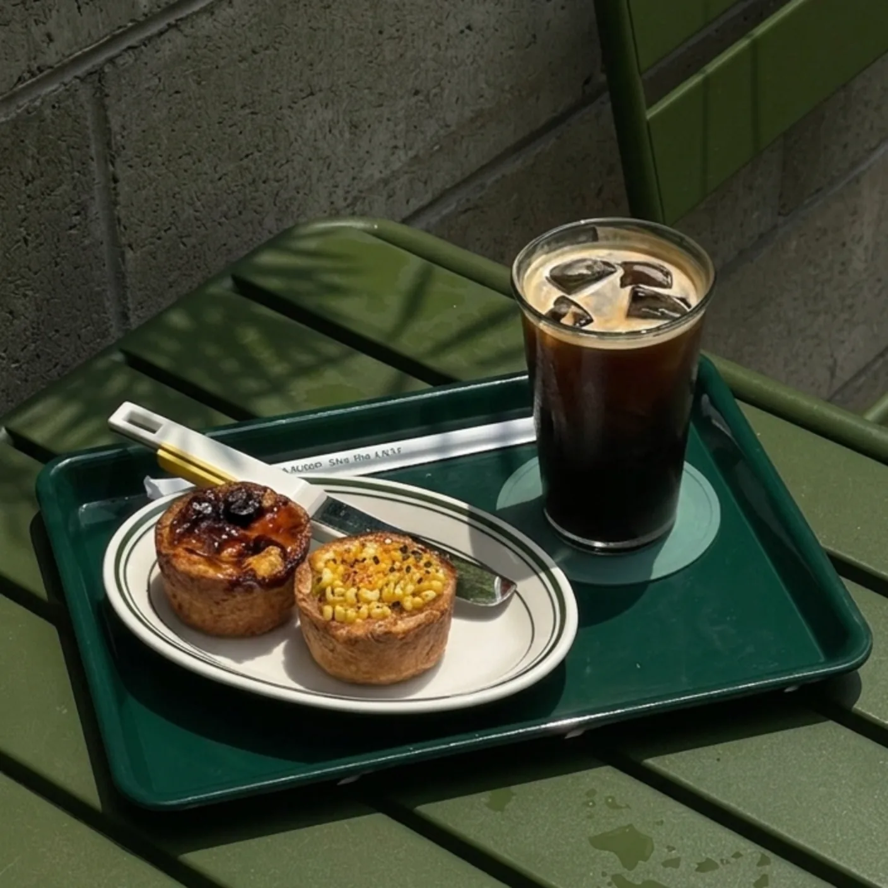
</p>

1. **侧光** — 优先利用靠窗座位的自然光。
2. **俯拍 45°** — 从上方向下倾斜约 45° 拍摄。
3. **2–4 倍变焦** — 与场景至少保持 2 米距离，使用 2–4 倍变焦。
4. **三角形排列** — 在画面三分之二区域内，将三个主体布置在三角形三个顶点。

> **小贴士：** 把较小的物件放在下方，避免遮挡后方较大的物件。

原版参考：[slay 构图详解](https://www.slaycamera.com/guides/triangle-1) · [相关摄影文章](https://www.slaycamera.com/blog/layered-foregrounds-tell-a-story)

<a id="guide-12"></a>

### 12. 三角形构图二：宽三角形横跨画面

把杯子、玻璃杯和餐盘等三个物件分布在整个桌面上，构成较宽的三角形，让画面呈现一个完整、有情节的场景。

<p>
  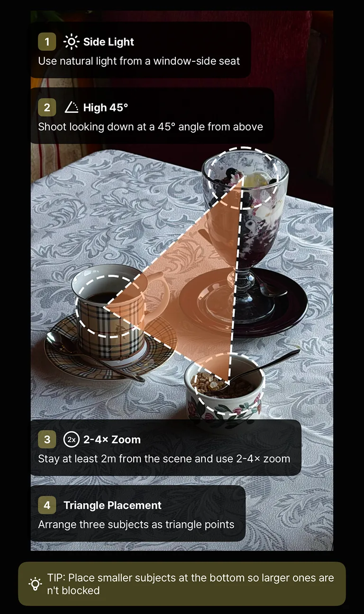
  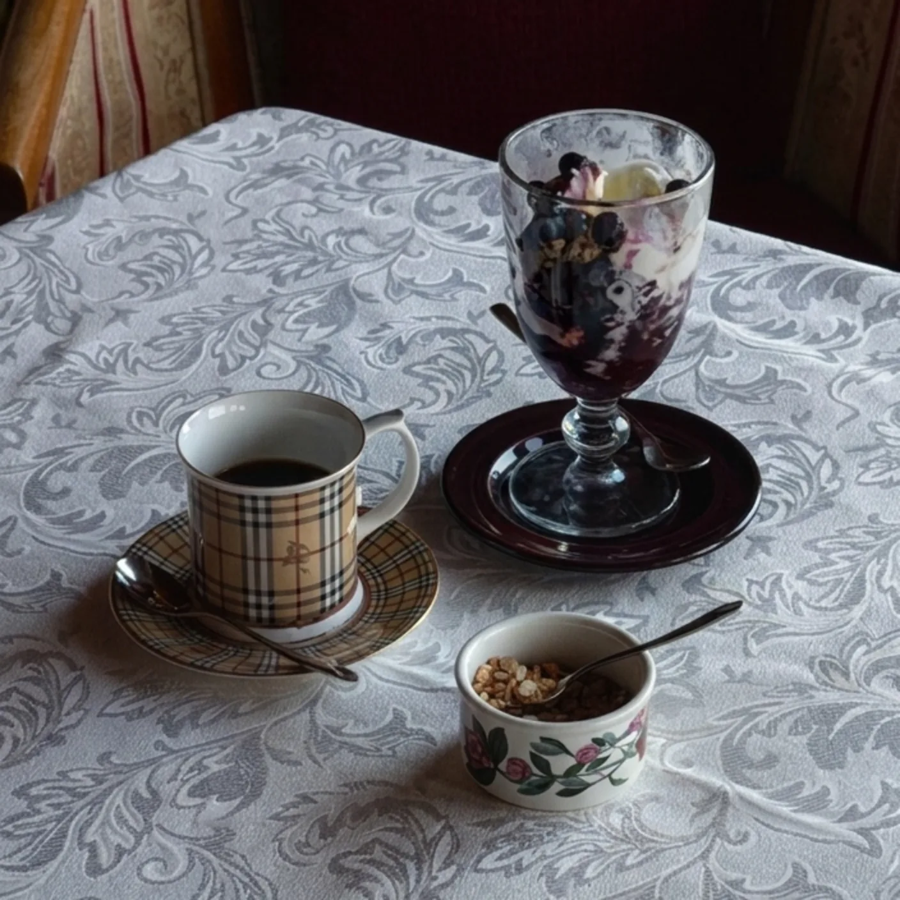
</p>

1. **侧光** — 优先利用靠窗座位的自然光。
2. **俯拍 45°** — 从上方向下倾斜约 45° 拍摄。
3. **2–4 倍变焦** — 与场景至少保持 2 米距离，使用 2–4 倍变焦。
4. **三角形排列** — 让三个主体分别占据三角形的三个顶点。

> **小贴士：** 把较小的物件放在下方，避免遮挡后方较大的物件。

原版参考：[slay 构图详解](https://www.slaycamera.com/guides/triangle-2) · [相关摄影文章](https://www.slaycamera.com/blog/tell-a-story-single-frame)

<a id="guide-13"></a>

### 13. 俯拍三角形构图：垂直俯拍、静物呈三角形

垂直俯拍桌面，让物件形成的三角形位于画面下方三分之二区域。俯视视角可把餐盘、杯子呈现为简洁的几何形状。

<p>
  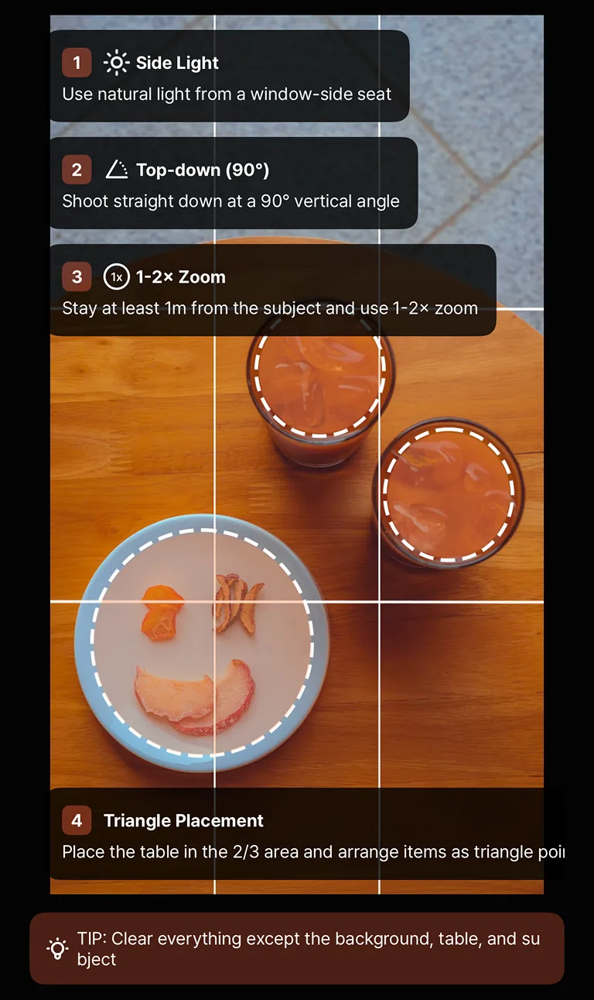
  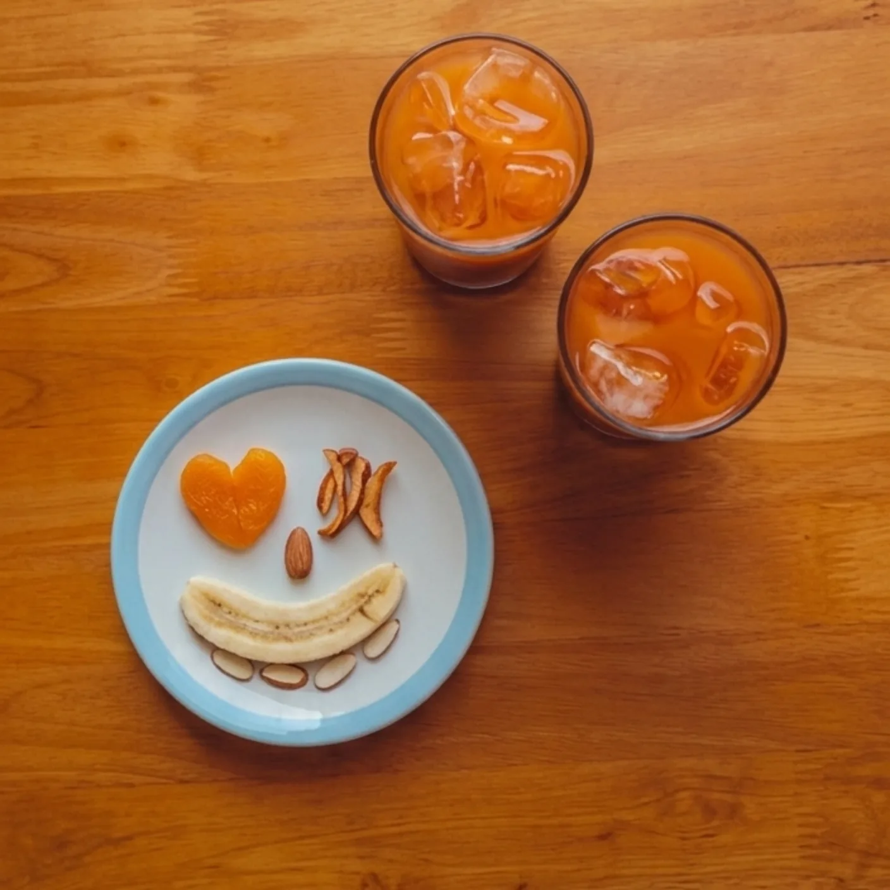
</p>

1. **侧光** — 优先利用靠窗座位的自然光。
2. **垂直俯拍 90°** — 相机朝正下方，以 90° 垂直角度拍摄。
3. **1–2 倍变焦** — 与主体至少保持 1 米距离，使用 1–2 倍变焦。
4. **三角形排列** — 让桌面占据画面三分之二区域，把物件安排成三角形三个顶点。

> **小贴士：** 移走无关杂物，只保留背景、桌面和拍摄主体。

原版参考：[slay 构图详解](https://www.slaycamera.com/guides/aerial-triangle) · [相关摄影文章](https://www.slaycamera.com/blog/negative-space-best-friend)

<a id="guide-14"></a>

### 14. 俯拍单主体构图：垂直俯拍、突出一道主菜

从正上方拍摄一道主菜，把它放在画面下方网格线的中央，让桌面占画面约三分之二。整体极简、图形感强，适合美食内容。

<p>
  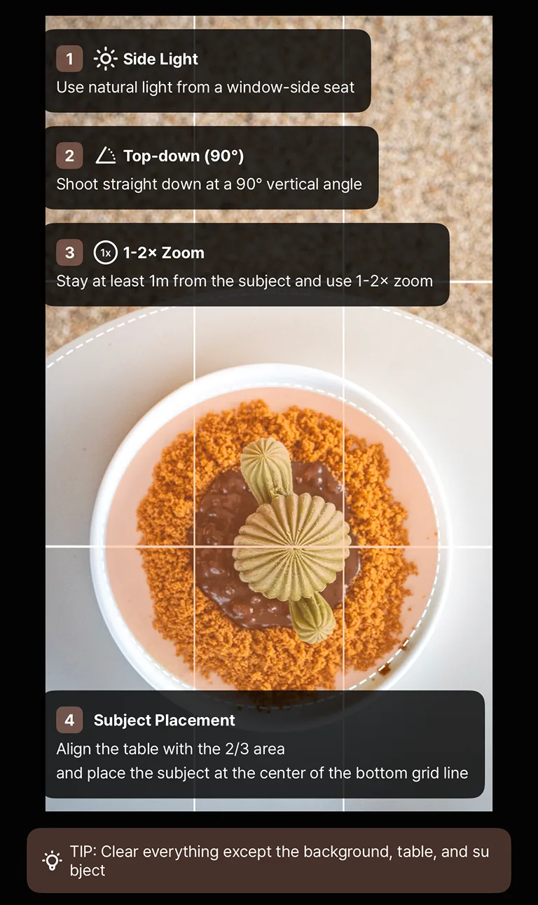
  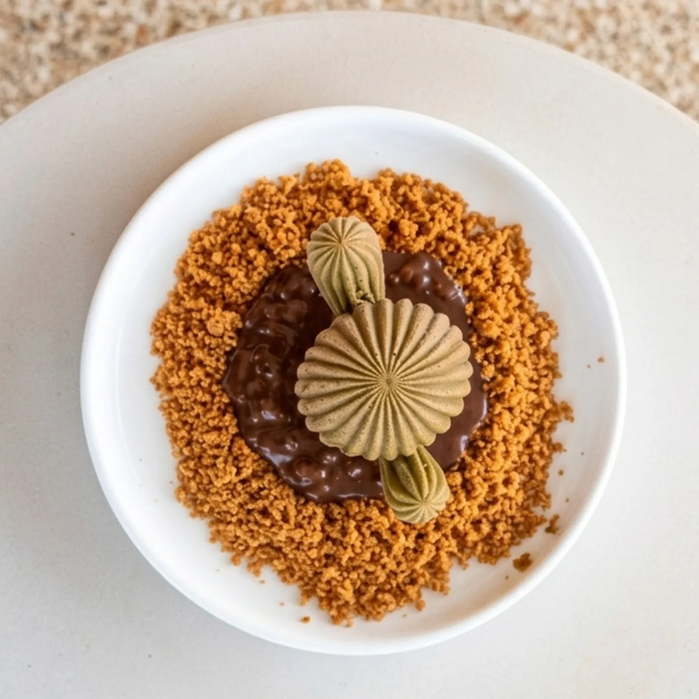
</p>

1. **侧光** — 优先利用靠窗座位的自然光。
2. **垂直俯拍 90°** — 相机朝正下方，以 90° 垂直角度拍摄。
3. **1–2 倍变焦** — 与主体至少保持 1 米距离，使用 1–2 倍变焦。
4. **主体位置** — 让桌面与画面三分之二区域对齐，将主菜放在下方网格线的中央。

> **小贴士：** 移走无关杂物，只保留背景、桌面和拍摄主体。

原版参考：[slay 构图详解](https://www.slaycamera.com/guides/one-point-aerial) · [相关摄影文章](https://www.slaycamera.com/blog/minimal-color-maximum-mood)

## 下载与使用数据

本仓库不仅是图文教程，还提供可导入摄影软件、Notion、Excel 或课程材料的结构化数据。

| 文件 | 用途 |
|---|---|
| [data/guides.zh-CN.json](data/guides.zh-CN.json) | 14 种构图的中文字段、拍摄步骤、提示和原版图片路径 |
| [data/guides.zh-CN.csv](data/guides.zh-CN.csv) | 对应的中文表格数据，每种构图一行 |
| [data/guides.json](data/guides.json) | 原版英文 JSON，保留原始键名和数据 |
| [data/guides.csv](data/guides.csv) | 原版英文 CSV，方便与原版核对 |

中文版 JSON 保留原始 `id`、`slug`、`diagram`、`example`、`url`、`article` 等标识符与引用路径，只翻译供人阅读的文本字段，并增加 `language: "zh-CN"`。

**中文 JSON 示例：**

```json
{
  "id": 1,
  "slug": "portrait-1",
  "name": "居中全身人像",
  "category": "人像摄影",
  "principle": "人物居中、完整呈现全身",
  "steps": [
    {
      "label": "相机高度",
      "detail": "将相机保持在被摄者胸口的高度。"
    }
  ],
  "url": "https://www.slaycamera.com/guides/portrait-1"
}
```

## 常见问题

**摄影构图指南是什么？**

它是一套可以重复使用的拍摄安排：用三分法、三角形、消失点等几何关系确定人物或景物在画面中的位置，再根据机位、距离和角度进行拍摄。

**必须使用 iPhone 吗？**

不必。原版指南针对 iPhone 编写，但只要手机或相机能显示构图网格线，就可以借鉴。不同设备的镜头倍率和视角不完全一样，需要灵活调整。

**这些图片与数据能用于课程、视频或博客吗？**

可以，包括商业用途；但必须遵守 CC BY 4.0 的署名要求，保留原作者 slay 和许可证信息，并说明是否做过修改（例如简体中文翻译）。

**可以直接在相机取景器里使用这些辅助线吗？**

原作者的 [slay iPhone 应用](https://apps.apple.com/app/id6807513456?utm_source=github&utm_medium=repo&utm_campaign=composition-guides) 支持在相机取景器中显示 14 种构图引导，辅助主体对齐。

## 许可与原作者署名

原版文字、数据、示意图和照片均按 [Creative Commons Attribution 4.0 International（CC BY 4.0）](LICENSE) 发布。引用、转发、改编时请保留作者署名与许可证链接，并明确标记修改内容。

> 构图资料原作者：[slay](https://www.slaycamera.com/?utm_source=github&utm_medium=repo&utm_campaign=composition-guides)（CC BY 4.0）。本分支为第三方简体中文翻译，非原作者的官方中文版本。

## 更多摄影学习资源

- [slay 原版 14 种构图指南](https://www.slaycamera.com/guides?utm_source=github&utm_medium=repo&utm_campaign=composition-guides)
- [按主题寻找摄影灵感](https://www.slaycamera.com/photo-ideas?utm_source=github&utm_medium=repo&utm_campaign=composition-guides)
- [构图与摄影知识文章](https://www.slaycamera.com/blog?utm_source=github&utm_medium=repo&utm_campaign=composition-guides)
- [免费电影风格 LUT](https://github.com/slaycamera/luts)
- [在 App Store 下载 slay](https://apps.apple.com/app/id6807513456?utm_source=github&utm_medium=repo&utm_campaign=composition-guides)

## 仓库文件结构

```text
README.md                  中文图文指南（当前文件）
README.en.md               英文原版指南
CHEATSHEET.md              中文一页速查表
CHEATSHEET.en.md           英文原版速查表
data/guides.zh-CN.json     简体中文 JSON 数据
data/guides.zh-CN.csv      简体中文 CSV 数据
data/guides.json           原版英文 JSON
data/guides.csv            原版英文 CSV
diagrams/                  14 张原版构图示意图
examples/                  14 张原版示例照片
LICENSE                    CC BY 4.0 原始许可证
```
